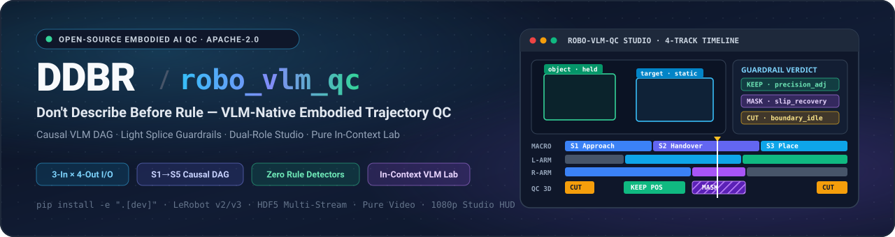
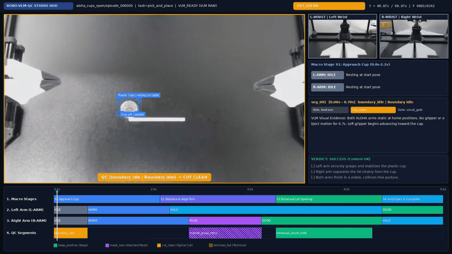
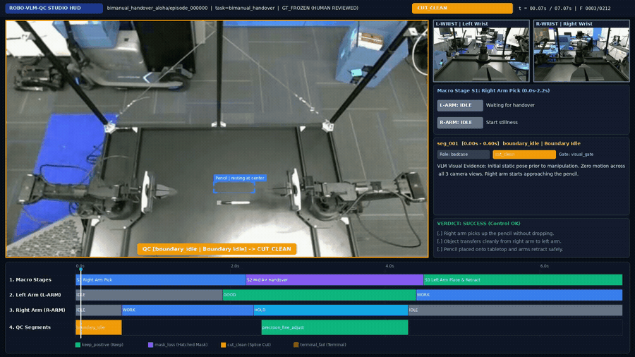
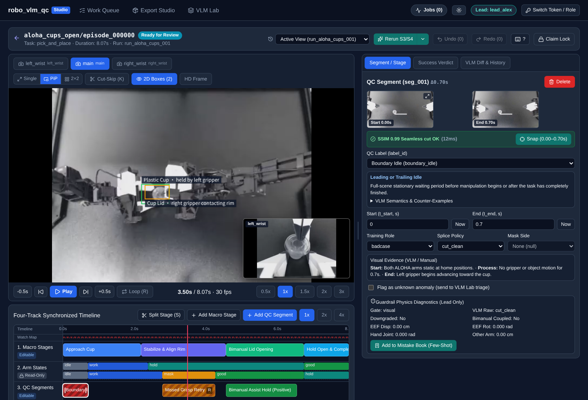
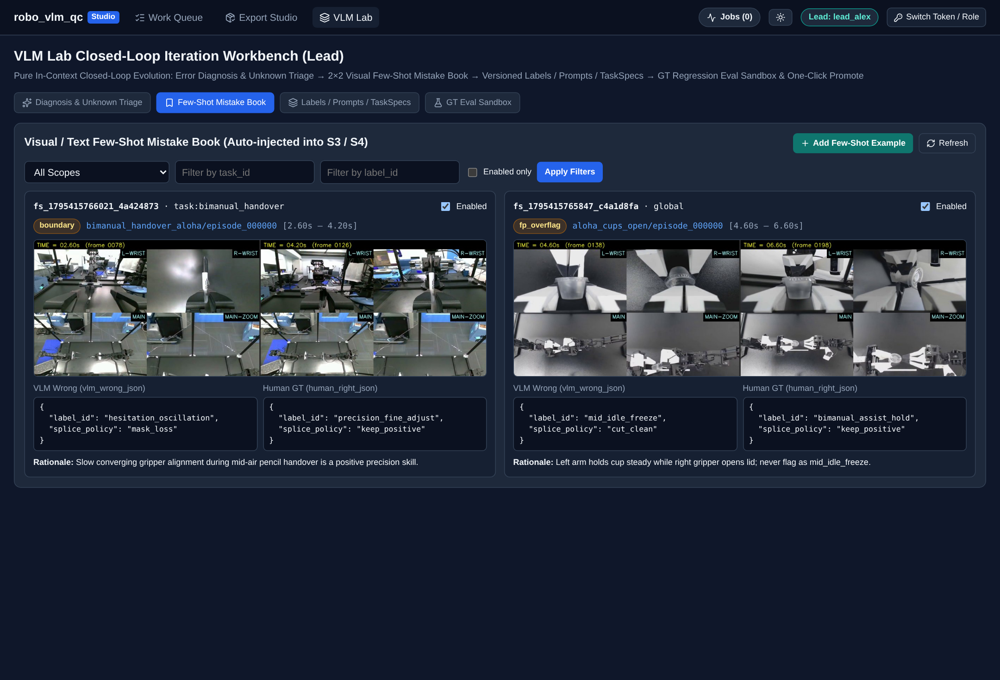
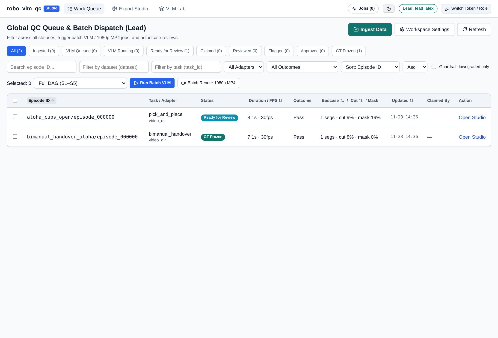
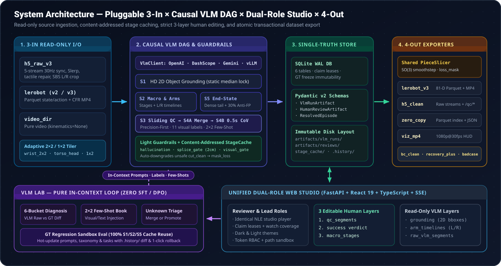

<p align="center">
  
</p>

<p align="center">
  <a href="LICENSE"></a>
  <a href="pyproject.toml"></a>
  <a href="web/package.json"></a>
  <a href="https://github.com/LVultimatefun/DDBR/actions/workflows/ci.yml"></a>
  <a href="docs/architecture.md"></a>
</p>

<p align="center">
  <strong>English</strong> · <a href="README_zh.md">Chinese</a>
  &nbsp;|&nbsp;
  <a href="#live-demo-showcase">Live Demos</a> ·
  <a href="#web-studio-gallery">Web Studio</a> ·
  <a href="#system-architecture">Architecture</a> ·
  <a href="#30-second-synthetic-demo-quickstart">Quickstart</a> ·
  <a href="#docker-deployment">Docker</a>
</p>

---

**DDBR (`robo_vlm_qc`)** — *Don't Describe Before Rule* — is a standalone, embodiment-agnostic quality-control and dataset-curation platform for robotics manipulation trajectories. Instead of brittle 30 Hz kinematic threshold heuristics, it runs a **causal multi-stage Vision-Language Model (VLM) DAG** paired with **lightweight splice-safety guardrails**, a **unified Dual-Role NLE Web Studio (`Reviewer` & `Lead`)**, a **pure In-Context `VLM Lab`** improvement loop (**zero VLM SFT/DPO/LoRA fine-tuning export**), and a pluggable **3-In × 4-Out** robotics data kernel.

---

## Live Demo Showcase

Rendered directly by `robo-vlm-qc render-mp4` (`viz_mp4` 1080p@30fps Studio HUD) on open-source multi-camera bimanual ALOHA episodes from HuggingFace LeRobot ([`lerobot/aloha_static_cups_open`](https://huggingface.co/datasets/lerobot/aloha_static_cups_open) & [`lerobot/aloha_static_pro_pencil`](https://huggingface.co/datasets/lerobot/aloha_static_pro_pencil)).

### 1. Bimanual Cup Opening (`aloha_static_cups_open`) — `cut_clean` · `mask_loss` · `keep_positive`

<p align="center">
  <a href="docs/assets/demo_aloha_cups_hud.mp4">
    
  </a>
</p>

<p align="center">
  <a href="docs/assets/demo_aloha_cups_hud.mp4"><strong>Watch / Download Full 720p@30fps MP4 (825 KB)</strong></a> ·
  Shows <code>HEAD + L-WRIST + R-WRIST</code> mosaic, live 2D object grounding, leading <code>boundary_idle</code> (<code>cut_clean</code>), right-arm <code>missed_grasp_retry</code> (hatched <code>mask_loss</code>), protected <code>bimanual_assist_hold</code> (<code>keep_positive</code>), and real-time completion criteria verification.
</p>

### 2. Mid-Air Bimanual Handover (`aloha_static_pro_pencil`) — Precision Skill Protection & GT Freeze

<p align="center">
  <a href="docs/assets/demo_aloha_handover_hud.mp4">
    
  </a>
</p>

<p align="center">
  <a href="docs/assets/demo_aloha_handover_hud.mp4"><strong>Watch / Download Full 720p@30fps MP4 (741 KB)</strong></a> ·
  Demonstrates Precision-First backbone protection on slow converging mid-air transfer (<code>precision_fine_adjust</code> → <code>keep_positive</code>), synchronized 4-track timeline, and frozen <code>GT_FROZEN (HUMAN REVIEWED)</code> status.
</p>

---

## Web Studio Gallery

Single FastAPI + React 19 + TypeScript + Vite SPA serving both `Reviewer` and `Lead` workflows with Dark & Light themes, live SSE jobs, and strict 3-layer human editing (`qc_segments`, `success`, `macro_stages`):

<table>
  <tr>
    <td width="50%" valign="top">
      <a href="docs/assets/studio_review_dark.png">
        
      </a>
      <br />
      <strong>Dual-Role NLE Review Studio (Dark)</strong> — Synchronized multi-cam PiP player, interactive 2D Grounding canvas, live Start/End SSIM cut-safety preview, and 4-track timeline.
    </td>
    <td width="50%" valign="top">
      <a href="docs/assets/studio_vlm_lab.png">
        
      </a>
      <br />
      <strong>VLM Lab (Pure In-Context Loop)</strong> — Automated 6-bucket diagnosis, 2×2 visual Few-Shot mistake book, unknown triage, versioned config diff/rollback, and GT regression sandbox.
    </td>
  </tr>
  <tr>
    <td width="50%" valign="top">
      <a href="docs/assets/studio_queue_light.png">
        
      </a>
      <br />
      <strong>Episode Queue &amp; Batch Orchestration (Light)</strong> — Dual Dark/Light themes, SQLite claim leases, cut/mask ratio telemetry, faceted filters, and read-only directory ingest.
    </td>
    <td width="50%" valign="top">
      <a href="docs/assets/studio_export.png">
        
      </a>
      <br />
      <strong>4-Out Transactional Export Center</strong> — Atomic <code>_staging → rename</code> bundles across <code>lerobot_v3</code>, <code>h5_clean</code>, <code>zero_copy_index</code>, and <code>viz_mp4</code> with 3 training recipes.
    </td>
  </tr>
</table>

---

## System Architecture

<p align="center">
  
</p>

### Causal VLM DAG, `StageCache` Isolation & Splice Guardrails

<p align="center">
  
</p>

See [`docs/architecture.md`](docs/architecture.md) for architectural decisions (D1–D8), Pydantic v2 schemas, SQLite WAL tables, cache-key isolation formulas, guardrail thresholds, and exporter specifications.

---

## Key Capabilities

- **3-In Pluggable Read-Only I/O Kernel ([`robo_vlm_qc/io/`](robo_vlm_qc/io/))**: Strictly read-only ingestion across `h5_raw_v3` (5-stream 30 Hz sync, Slerp, tactile repair, SBS L/R crop), `lerobot` (v2/v3 Parquet + MP4), and `video_dir` (`kinematics=None`), paired with camera-role-adaptive 2×2 / 1×2 tiling (`wrist_2x2`, `torso_head_2x2`, `single_1x2`).
- **Causal VLM DAG & Light Guardrails ([`robo_vlm_qc/vlm/`](robo_vlm_qc/vlm/), [`robo_vlm_qc/guardrail/`](robo_vlm_qc/guardrail/))**: Multi-provider `httpx` `VlmClient` (OpenAI-compatible, DashScope, Gemini, local vLLM), stage-level heterogeneous model routing, dynamic duration token budgets, content-addressed `StageCache`, and 3-level concurrent DAG `S0 → S1 → (S2 ∥ S5) → S3 → S4A → S4B`. Lightweight guardrails (`hallucination`, `splice_gate`, `visual_gate`) never invent labels — they protect continuity by auto-downgrading unsafe `cut_clean` intervals to `mask_loss`.
- **11 Pure-Visual Labels ([`configs/labels.yaml`](configs/labels.yaml))**: Strictly visual taxonomy decoupled from splice policies, paired with Precision-First stage prompts ([`configs/prompts/`](configs/prompts/)) and generic task specs ([`configs/tasks/`](configs/tasks/)).
- **Single-Truth Store ([`robo_vlm_qc/store/`](robo_vlm_qc/store/))**: Authoritative Pydantic v2 schemas (`VlmRunArtifact`, `HumanReviewArtifact`, `ResolvedEpisode`) backed by SQLite WAL (`robo_vlm_qc.db`), immutable JSON artifacts (`artifacts/`), and `.history/` configuration snapshots.
- **`VLM Lab` Pure In-Context Loop ([`robo_vlm_qc/lab/`](robo_vlm_qc/lab/))**: Automated 6-bucket error diagnosis (`VLM Raw vs Human GT`), 1-click 2×2 visual/text Few-Shot mistake book injected into S3/S4, unknown anomaly triage (`merge` / `promote`), `.history/` diff & 1-click rollback, advisory LLM prompt diffs (`prompt_assist`), and GT regression eval sandbox reusing S1/S2/S5 cache 100% (**strictly In-Context — zero VLM SFT/DPO/LoRA export**).
- **4-Out Transactional Exporters ([`robo_vlm_qc/export/`](robo_vlm_qc/export/))**: Shared `PieceSlicer` (smoothstep + SO(3) geodesic tail smoothing, `is_tail`, `action_loss_mask`, `subtask_index`, canonical 81-D kinematics) and atomic `_staging → rename` exporters (`lerobot_v3`, `h5_clean`, `zero_copy_index`, `viz_mp4`) across 3 recipes (`bc_clean`, `recovery_plus`, `badcase_pairs`).

---

## 30-Second Synthetic Demo Quickstart

Try `robo_vlm_qc` end-to-end with zero external datasets or API keys:

### 1. Prerequisites & Install

- **Python** `>= 3.12`
- **FFmpeg** (`ffmpeg` and `ffprobe` on `PATH`)
- **Node.js** `>= 22` and `npm` (required once to build the Web Studio frontend)

```bash
git clone https://github.com/LVultimatefun/DDBR.git
cd DDBR

# Install Python package + CLI (`robo-vlm-qc`)
pip install -e ".[dev]"

# Build Web Studio frontend bundle (`web/dist/`)
cd web && npm ci && npm run build && cd ..
```

### 2. Generate Synthetic Demo Data, Ingest, and Launch Studio

```bash
# Generate 2 multi-camera video_dir episodes + 1 LeRobot v3 episode (with 81-D kinematics)
python scripts/generate_demo_dataset.py --out ./demo_data

# Ingest strictly read-only into a local workspace
robo-vlm-qc -w ./workspace ingest --data ./demo_data

# Launch Dual-Role Studio locally on 127.0.0.1:8000 (unauthenticated loopback dev mode)
robo-vlm-qc -w ./workspace serve --no-auth
```

Open `http://127.0.0.1:8000` in your browser to explore the Queue, multi-camera Review Studio, Export Center, and `VLM Lab`.

> **Security Note**: `robo-vlm-qc serve` binds `127.0.0.1` by default and requires explicit tokens (`--reviewer-token` / `--lead-token` or `ROBO_VLM_QC_*_TOKEN`) unless `--no-auth` is passed. For shared LAN or Docker deployments, always configure distinct tokens, `--allowed-data-roots`, and `--cors-origin` / `ROBO_VLM_QC_CORS_ORIGINS`.

---

## Running the Full VLM QC & Export Pipeline

### 1. Configure Credentials & Provider Preset

```bash
cp .env.example .env
# Edit .env and set OPENAI_API_KEY (or another provider key below)
```

[`configs/default.yaml`](configs/default.yaml) defaults to an OpenAI-compatible endpoint (`https://api.openai.com/v1`, `OPENAI_API_KEY`, `gpt-4o`, `thinking: false`, `thinking_mode: auto`). Ready-to-use provider presets live in [`configs/presets/`](configs/presets/):

| Preset File | Provider | Default Model | API Key Env | Thinking Mode |
| :--- | :--- | :--- | :--- | :--- |
| [`configs/presets/openai.yaml`](configs/presets/openai.yaml) | `openai_compat` | `gpt-4o` | `OPENAI_API_KEY` | `disabled` (`thinking: false`) |
| [`configs/presets/dashscope.yaml`](configs/presets/dashscope.yaml) | `openai_compat` | `qwen-vl-max` | `DASHSCOPE_API_KEY` | `dashscope` (`thinking: true`) |
| [`configs/presets/gemini.yaml`](configs/presets/gemini.yaml) | `gemini` | `gemini-2.5-pro` | `GEMINI_API_KEY` | `auto` (`thinking: true`) |
| [`configs/presets/vllm.yaml`](configs/presets/vllm.yaml) | `openai_compat` | `Qwen/Qwen2.5-VL-72B-Instruct` | `VLLM_API_KEY` | `disabled` (`thinking: false`) |

Activate any preset by copying it to `<workspace>/configs_override/default.yaml`:

```bash
mkdir -p ./workspace/configs_override
cp configs/presets/gemini.yaml ./workspace/configs_override/default.yaml
```

### 2. Run VLM DAG, Review, Evaluate, and Export

```bash
# 1. Run causal VLM DAG (S1 -> S2||S5 -> S3 -> S4A -> S4B) + light guardrails
robo-vlm-qc -w ./workspace run-vlm --workers 4

# 2. Launch authenticated Dual-Role Studio
robo-vlm-qc -w ./workspace serve \
  --reviewer-token "$ROBO_VLM_QC_REVIEWER_TOKEN" \
  --lead-token "$ROBO_VLM_QC_LEAD_TOKEN" \
  --allowed-data-roots ./demo_data

# 3. (After Lead freezes GT episodes) Run VLM Lab GT regression sandbox
robo-vlm-qc -w ./workspace eval --few-shot --json

# 4. Export curated training datasets (4 formats x 3 recipes)
robo-vlm-qc -w ./workspace export \
  --format lerobot_v3 \
  --recipe bc_clean \
  --out ./exports/lerobot_bc_clean

# 5. Render standalone 1080p@30fps Studio HUD visualization MP4s
robo-vlm-qc -w ./workspace render-mp4 --all-ready
```

---

## Docker Deployment

Build and run the complete FastAPI + React Studio stack (multi-stage Node 22 + Python 3.12 + FFmpeg) via [`Dockerfile`](Dockerfile) and [`docker-compose.yml`](docker-compose.yml):

```bash
cp .env.example .env
# Edit .env to set ROBO_VLM_QC_REVIEWER_TOKEN, ROBO_VLM_QC_LEAD_TOKEN, and your VLM API key

mkdir -p workspace data
docker compose up --build
```

The Compose stack mounts `./workspace` (read-write) and `./data` (read-only, enforced by `--allowed-data-roots /data`), reads `.env`, and serves Studio on `http://localhost:8000`.

---

## Core Concepts Summary

| Dimension | Design Summary |
| :--- | :--- |
| **3-In Adapters** | `h5_raw_v3` (5-stream 30 Hz sync, Slerp, tactile repair, SBS L/R crop, O(K) JPEG), `lerobot` (v2/v3 Parquet + MP4), `video_dir` (pure-video `kinematics=None`). |
| **4-Out Exporters** | `lerobot_v3` (81-D Parquet, configurable `export.robot_type` default `"bimanual_robot"`, CFR MP4s, `subtasks.parquet`, `info.json`, `stats.json`), `h5_clean` (sliced raw streams + `/qc/*`), `zero_copy_index` (`qc_index.parquet`, `manifest.jsonl`, `subtasks.json`), `viz_mp4` (1920×1080@30fps HUD). |
| **3 Export Recipes** | `bc_clean` (passed episodes, positive segments + safe `cut_clean` removed, `mask_loss` masked to `0.0`), `recovery_plus` (also unmasks `recovery` segments), `badcase_pairs` (badcase/terminal_fail + context windows for contrast/failure analysis). |
| **11 Pure-Visual Labels** | `boundary_idle`, `mid_idle_freeze`, `missed_grasp_retry`, `object_slip_recovery`, `placement_redo`, `hesitation_oscillation`, `collision_or_knock`, `precision_fine_adjust`, `bimanual_assist_hold`, `terminal_failure`, `unknown_anomaly`. |
| **Example Tasks** | [`_default.yaml`](configs/tasks/_default.yaml), [`pick_and_place.yaml`](configs/tasks/pick_and_place.yaml), [`bimanual_handover.yaml`](configs/tasks/bimanual_handover.yaml). |
| **Causal DAG & Cache** | `S1` (2D Grounding) → `S2 ∥ S5` (Macro Backbone + L/R Timelines ∥ Dense-Tail Success + 30% Anti-FP Control) → `S3` (Sliding QC Discovery w/ S2 protection & Few-Shot) → `S4A/S4B` (Merge + 0.5s CoV Diff). Updating S3/labels/few-shots reuses S1/S2/S5 `StageCache` 100%. |
| **Dual-Role 3-Layer Editing** | `Reviewer` and `Lead` share identical `ReviewStudioPage` rendering. Humans edit only `qc_segments`, `success`, and `macro_stages`; `grounding`, `arm_timelines`, and `raw_vlm_segments` remain read-only. |
| **`VLM Lab` In-Context Loop** | `GT Freeze` → `Diagnosis (6 buckets)` → `2×2 Visual Few-Shot` / `Unknown Triage` / `Versioned Taxonomy` → `GT Sandbox Eval` → `Promote` (with `.history/` backup). **Zero VLM SFT/DPO/LoRA export.** |

---

## Documentation & Community

- **[`docs/architecture.md`](docs/architecture.md)** — System architecture decisions, visual diagrams, Pydantic v2 & SQLite WAL schemas, `StageCache` isolation, guardrail thresholds, `PieceSlicer`, and 4 exporters.
- **[`docs/operations.md`](docs/operations.md)** — Complete CLI reference, YAML configs & provider presets, canonical FastAPI REST/SSE & RBAC contracts, Dual-Role Studio workflow, and `VLM Lab` In-Context SOP.
- **[`AGENTS.md`](AGENTS.md)** — Repository architecture map, dev/test/build toolchain, data-safety & architectural redlines, and Living Documentation Rules.
- **[`CONTRIBUTING.md`](CONTRIBUTING.md)** — Development setup, testing guide, and pull request checklist.
- **[`SECURITY.md`](SECURITY.md)** — Security policy and deployment hardening guidelines.
- **[`CODE_OF_CONDUCT.md`](CODE_OF_CONDUCT.md)** — Community standards (Contributor Covenant v2.1).
- **[`LICENSE`](LICENSE)** — Apache License 2.0.
