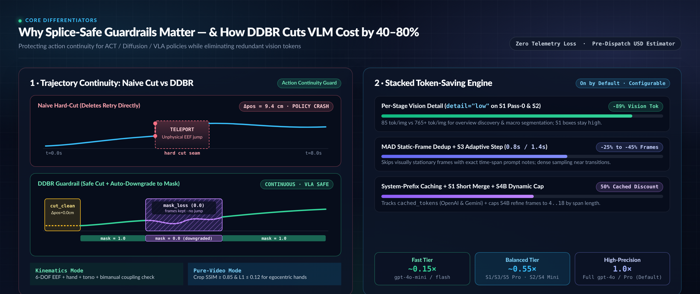
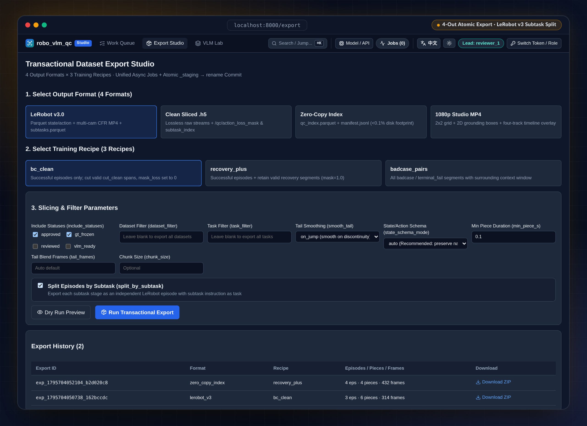
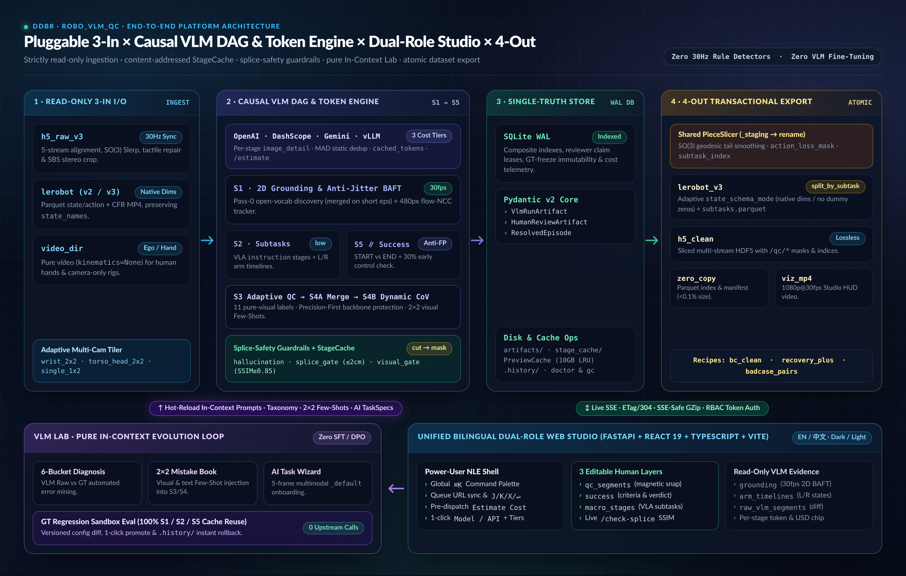

<p align="center">
  
</p>

<p align="center">
  <a href="LICENSE"></a>
  <a href="pyproject.toml"></a>
  <a href="web/package.json"></a>
  <a href="https://github.com/LVultimatefun/DDBR/actions/workflows/ci.yml"></a>
  <a href="docs/architecture.md"></a>
  <a href="#60-second-zero-api-key-quickstart"></a>
</p>

<p align="center">
  <strong>English</strong> · <a href="README_zh.md">Chinese</a>
  &nbsp;|&nbsp;
  <a href="#live-demo">Demo</a> ·
  <a href="#why-ddbr">Why DDBR</a> ·
  <a href="#60-second-zero-api-key-quickstart">Quickstart</a> ·
  <a href="#web-studio-gallery">Web Studio</a> ·
  <a href="#architecture--causal-vlm-dag">Architecture</a> ·
  <a href="#token-cost-engine">Token Engine</a> ·
  <a href="#ecosystem-matrix">Ecosystem</a> ·
  <a href="#citation">Citation</a>
</p>

---

> **DDBR (`robo_vlm_qc`)** — *Don't Describe Before Rule* — is an open-source, embodiment-agnostic **trajectory quality-control & dataset-curation platform** for robot manipulation and egocentric human-hand videos (ALOHA, Franka, bimanual humanoids, Ego4D / Epic-Kitchens). Instead of brittle 30 Hz kinematic thresholds or unsafe hard cuts that crash VLA training, DDBR pairs a **causal S1→S5 VLM DAG** and **splice-safety guardrails** with a **bilingual Dual-Role NLE Web Studio**, a **pure In-Context `VLM Lab`** (**zero VLM SFT/DPO/LoRA fine-tuning**), and an atomic **3-In × 4-Out** LeRobot v3 data kernel.

---

## Live Demo

### 45-Second End-to-End Studio Walkthrough

<p align="center">
  <a href="docs/assets/studio_walkthrough_45s.mp4">
    
  </a>
</p>

<p align="center">
  <a href="docs/assets/studio_walkthrough_45s.mp4"><strong>Watch Full 720p@30fps MP4 (42s · 1.65 MB)</strong></a> &nbsp;·&nbsp;
  Dark NLE Studio on open-source ALOHA · 30fps BAFT 2D tracking · SSIM <code>cut_clean → mask_loss</code> guardrail · <code>EN / ZH</code> &amp; <code>Model / API</code> modal · 5-frame AI TaskSpec Wizard · transactional <code>lerobot_v3</code> subtask export.
</p>

---

## Why DDBR?

Teleoperation and egocentric demonstration datasets are full of leading/trailing stalls, missed grasps, retries, and hesitation — yet **naively hard-cutting bad frames breaks position/velocity continuity and destabilizes ACT, Diffusion Policy, and VLA training**.

| Capability | Raw Teleop / Video | Naive Hard-Cut | 30 Hz Rule Thresholds | **DDBR (`robo_vlm_qc`)** |
| :--- | :---: | :---: | :---: | :---: |
| **Removes boundary stalls & bad segments** | No | Yes | Partial | **Yes (11 pure-visual labels)** |
| **Protects action continuity (no teleports)** | Yes | **Breaks policy** | Fragile | **Auto-downgrades unsafe `cut_clean → mask_loss`** |
| **Works on pure-video / human hands** | Yes | Yes | **No (needs joints)** | **Yes (`visual_gate` SSIM/L1 + ego prompts)** |
| **Protects slow precision / assist skills** | Yes | Often over-cuts | False positives | **Precision-First S2 backbone protection** |
| **Improves accuracy without fine-tuning** | — | — | Manual tuning | **Pure In-Context `VLM Lab` (2×2 Few-Shot + GT Eval)** |
| **Predictable VLM cost & local-first ops** | — | — | Free | **40–80% Token Engine + pre-dispatch USD estimate** |

<p align="center">
  
</p>

---

## 60-Second Zero-API-Key Quickstart

Evaluate the full Dual-Role NLE Web Studio, dense 2D BAFT grounding, guardrail downgrade diagnostics, `⌘K` Command Palette, cost telemetry, and `lerobot_v3` Export Center **with zero dataset downloads and zero VLM API keys**.

**Prerequisites**: Python `>= 3.12`, FFmpeg (`ffmpeg` + `ffprobe`), Node.js `>= 22`.

```bash
# 1. Clone, install Python package + CLI, and build Web Studio bundle
git clone https://github.com/LVultimatefun/DDBR.git && cd DDBR
pip install -e ".[dev]" && (cd web && npm ci && npm run build)

# 2. Generate synthetic video_dir + 81-D LeRobot v3 episodes AND offline pre-annotated VLM runs
python scripts/generate_demo_dataset.py --out ./demo_data --with-sample-run --workspace ./workspace

# 3. Launch Dual-Role Studio locally (http://127.0.0.1:8000)
robo-vlm-qc -w ./workspace serve --no-auth
```

> **Useful Diagnostics**: Run `robo-vlm-qc -w ./workspace doctor` to verify Python/OpenCV/FFmpeg/DB/VLM health, or `robo-vlm-qc -w ./workspace gc --dry-run` to inspect `PreviewCache` LRU disk usage (default cap `10 GB`).  
> **Security Note**: `serve` binds `127.0.0.1` by default and enforces explicit `--reviewer-token` / `--lead-token` unless `--no-auth` is passed. For LAN/Docker deployments, always set distinct tokens, `--allowed-data-roots`, and `--cors-origin`.

---

## Web Studio Gallery

Single route-lazy-loaded **FastAPI + React 19 + TypeScript + Vite** SPA serving both `Reviewer` and `Lead` workflows with **Dark & Light themes**, live **`EN / ZH` switching**, global **`Cmd+K` Command Palette**, one-click **`Model / API` + Cost-Tier modal**, live SSE jobs, and strict 3-layer human editing (`qc_segments`, `success`, `macro_stages`).

<table>
  <tr>
    <td width="50%" valign="top">
      <a href="docs/assets/studio_review_dark.png">
        
      </a>
      <br />
      <strong>Dual-Role NLE Review Studio (Dark)</strong> — Synchronized multi-cam PiP player with 30fps BAFT 2D boxes, header run-cost &amp; cache-hit chip, live SSIM cut-safety preview, cursor-anchored timeline zoom + magnetic snap guide, and <code>Display &amp; Shortcuts</code> popover.
    </td>
    <td width="50%" valign="top">
      <a href="docs/assets/studio_queue_light.png">
        
      </a>
      <br />
      <strong>Global Queue &amp; Batch Orchestration (Light)</strong> — URL-synced filters, <code>J/K/X/Enter//</code> keyboard flow, <code>Tokens / Cost</code> telemetry column, pre-dispatch <code>Estimate Cost</code> popover, <code>Unrecognized (_default)</code> triage, and <code>+ New Task (AI)</code> wizard.
    </td>
  </tr>
  <tr>
    <td width="50%" valign="top">
      <a href="docs/assets/studio_vlm_lab.png">
        
      </a>
      <br />
      <strong>VLM Lab (Pure In-Context Loop)</strong> — Modular 4-tab workbench: 6-bucket GT error diagnosis, 2×2 visual Few-Shot mistake book injected into S3/S4, unknown anomaly triage, versioned config diff/rollback (<code>.history/</code>), and 100%-cache-reusing GT sandbox eval.
    </td>
    <td width="50%" valign="top">
      <a href="docs/assets/studio_export.png">
        
      </a>
      <br />
      <strong>4-Out Transactional Export Studio</strong> — Atomic <code>_staging → rename</code> bundles across <code>lerobot_v3</code> (adaptive <code>state_schema_mode</code> + <code>split_by_subtask</code>), <code>h5_clean</code>, <code>zero_copy_index</code>, and <code>viz_mp4</code> with live export history &amp; ZIP downloads.
    </td>
  </tr>
</table>

---

## Architecture & Causal VLM DAG

<p align="center">
  
</p>

<p align="center">
  
</p>

### Core Engineering Highlights

<table>
  <tr>
    <td width="50%" valign="top">
      <strong>1. Anti-Jitter BAFT 2D Tracking (0 Extra VLM Calls)</strong><br />
      Pass-0 open-vocabulary discovery (auto-merged into Batch 0 on short episodes), ORB+RANSAC fixed-vs-moving camera detection, Batch-0 spatial anchoring, and 480px bidirectional DIS flow + NCC tracking with monotonic DP and phantom-anchor rejection.
    </td>
    <td width="50%" valign="top">
      <strong>2. Splice-Safety Guardrails &amp; Subtask Sync</strong><br />
      Lightweight post-gates (<code>hallucination</code>, 6-DOF <code>splice_gate</code>, pure-video <code>visual_gate</code>) never invent labels — they protect continuity by downgrading unsafe <code>cut_clean</code> spans to <code>mask_loss</code>. S2 generates VLA <code>instruction</code> subtasks with on-demand <code>/infer-subtasks</code>.
    </td>
  </tr>
  <tr>
    <td width="50%" valign="top">
      <strong>3. AI TaskSpec Onboarding for Unseen Tasks</strong><br />
      Unmatched episodes route to <code>_default</code> with a 1-click filter and inline/batch reassignment. Leads open <strong>+ New Task (AI)</strong> with any natural-language brief + 5 keyframes to synthesize a normalized English S1–S5 <code>TaskSpec</code> in seconds.
    </td>
    <td width="50%" valign="top">
      <strong>4. Single-Truth Store &amp; Pure In-Context Lab</strong><br />
      Pydantic v2 contracts backed by indexed SQLite WAL, immutable JSON artifacts, SSE-safe GZip, strong <code>ETag/304</code> media caching, and 10 GB LRU <code>PreviewCache</code>. <code>VLM Lab</code> iterates strictly via prompts, taxonomy &amp; 2×2 Few-Shots — <strong>zero VLM SFT/DPO/LoRA export</strong>.
    </td>
  </tr>
</table>

See [`docs/architecture.md`](docs/architecture.md) for architectural decisions (D1–D8), Pydantic schemas, SQLite tables, and `StageCache` formulas.

---

## Token Cost Engine

All token-saving levers are **enabled by default with conservative, accuracy-safe thresholds** in [`configs/default.yaml`](configs/default.yaml) (keeping OpenAI `gpt-4o` as the default model baseline) and can be toggled individually or paired with one-click Cost Tiers in the TopNav `Model / API` modal.

| Optimization Lever | Scope | Mechanism | Typical Impact |
| :--- | :--- | :--- | :--- |
| **Per-Stage `image_detail`** | `S1 Pass-0`, `S2` | Uses OpenAI `detail="low"` / Gemini `MEDIA_RESOLUTION_LOW` (~85 vs 765+ tok/img) with calibrated blind-node guard; S1 boxes stay `high` | **-89% vision tokens** on S2 &amp; Pass-0 |
| **MAD Static-Frame Dedup** | `S2`, `S3` | Downsampled grayscale MAD skips stationary duplicate frames and injects exact omitted time ranges into prompts | **-20% to -40% frames** on idle-heavy demos |
| **Adaptive Step Sampling** | `S3` | Samples finely (`0.8s`) near stage transitions &amp; edges, coarsely (`1.4s`) inside calm single-stage interiors | **-20% to -30% S3 tokens** |
| **Short-Episode S1 Merge** | `S1` | Merges Pass-0 object discovery + Batch-0 grounding into 1 call when keyframes `<= batch_size` | **-1 VLM round-trip** per short episode |
| **System-Prefix Caching** | `S3`, `S4B` | Hoists static task rules &amp; label registry into stable `system` prefix; tracks `cached_tokens` &amp; applies 50% cached-input pricing | **Up to 50% input discount** across windows |
| **Dynamic Refine Frame Cap** | `S4B` | Scales refine frames (`4..18`) dynamically to candidate span length + skips kinematics-verified edge `boundary_idle` | **-35% to -60% S4B tokens** |
| **Cost Tiers &amp; Pre-Dispatch Estimator** | `API / UI` | One-click **Fast (`~0.15×`) / Balanced (`~0.55×`) / High-Precision (`1.0×`)** presets + `POST /api/jobs/estimate` zero-call USD preview | **Up to -85% spend** with zero billing surprises |

---

## Ecosystem Matrix

### 3-In Read-Only Sources × 4-Out Transactional Exporters

| 3-In Adapters (`robo_vlm_qc/io/`) | Key Features | 4-Out Exporters (`robo_vlm_qc/export/`) | Key Features |
| :--- | :--- | :--- | :--- |
| **`h5_raw_v3`** | 5-stream 30 Hz sync, SO(3) Slerp, tactile repair, SBS L/R crop | **`lerobot_v3`** | Adaptive `state_schema_mode` (preserves native dims or skips dummy zeros on pure video) + `subtasks.parquet` + optional `split_by_subtask` |
| **`lerobot` (v2 / v3)** | Parquet state/action + CFR MP4, preserves `state_names` / `action_names` | **`h5_clean`** | Lossless sliced multi-stream HDF5 with `/qc/action_loss_mask` &amp; `subtask_index` |
| **`video_dir`** | Multi-cam or single-cam pure video (`kinematics=None`, human hands / Ego4D) | **`zero_copy_index`** | Lightweight `qc_index.parquet`, `manifest.jsonl`, `subtasks.json` (&lt;0.1% disk size) |
| **Adaptive Tiler** | `wrist_2x2` · `torso_head_2x2` · `single_1x2` | **`viz_mp4`** | 1920×1080@30fps Studio HUD MP4 with 2D grounding &amp; 4-track timeline |

### Ready-to-Use VLM Provider Presets

Configure via TopNav **`Model / API`** modal (API keys stored strictly in `<workspace>/.env` with `0600` permissions), `robo-vlm-qc config-vlm`, or [`configs/presets/`](configs/presets/):

| Preset | Provider | Default Model | API Key Env | Thinking Mode |
| :--- | :--- | :--- | :--- | :--- |
| [`openai.yaml`](configs/presets/openai.yaml) | `openai_compat` | `gpt-4o` | `OPENAI_API_KEY` | `disabled` (`thinking: false`) |
| [`dashscope.yaml`](configs/presets/dashscope.yaml) | `openai_compat` | `qwen-vl-max` | `DASHSCOPE_API_KEY` | `dashscope` (`thinking: true`) |
| [`gemini.yaml`](configs/presets/gemini.yaml) | `gemini` | `gemini-2.5-pro` | `GEMINI_API_KEY` | `auto` (`thinking: true`) |
| [`vllm.yaml`](configs/presets/vllm.yaml) | `openai_compat` | `Qwen/Qwen2.5-VL-72B-Instruct` | `VLLM_API_KEY` | `disabled` (`thinking: false`) |

---

## Deep-Dive Guides (Click to Expand)

<details>
<summary><strong>Full VLM QC, Evaluation &amp; Export CLI Pipeline</strong></summary>

```bash
# 1. One-line VLM provider configuration & live connectivity probe
robo-vlm-qc -w ./workspace config-vlm \
  --preset openai \
  --api-key "$OPENAI_API_KEY" \
  --model gpt-4o \
  --test

# 2. Ingest read-only datasets & run causal VLM DAG + guardrails
robo-vlm-qc -w ./workspace ingest --data /path/to/lerobot_or_h5_or_videos
robo-vlm-qc -w ./workspace run-vlm --workers 4

# 3. Launch authenticated Dual-Role Studio (with path sandbox)
robo-vlm-qc -w ./workspace serve \
  --reviewer-token "$ROBO_VLM_QC_REVIEWER_TOKEN" \
  --lead-token "$ROBO_VLM_QC_LEAD_TOKEN" \
  --allowed-data-roots /path/to/lerobot_or_h5_or_videos

# 4. Run VLM Lab GT regression sandbox (100% S1/S2/S5 cache reuse)
robo-vlm-qc -w ./workspace eval --few-shot --json

# 5. Export curated LeRobot v3 datasets (with optional per-subtask episode splitting)
robo-vlm-qc -w ./workspace export \
  --format lerobot_v3 \
  --recipe bc_clean \
  --status approved --status gt_frozen --status reviewed \
  --state-schema-mode auto \
  --split-by-subtask \
  --out ./exports/lerobot_subtasks

# 6. Render 1080p@30fps Studio HUD MP4s & run workspace maintenance
robo-vlm-qc -w ./workspace render-mp4 --all-ready
robo-vlm-qc -w ./workspace doctor --json
robo-vlm-qc -w ./workspace gc --max-cache-gb 10
```

</details>

<details>
<summary><strong>Docker Compose Deployment</strong></summary>

Build and run the multi-stage Node 22 + Python 3.12 + FFmpeg container stack via [`Dockerfile`](Dockerfile) and [`docker-compose.yml`](docker-compose.yml):

```bash
cp .env.example .env
# Set ROBO_VLM_QC_REVIEWER_TOKEN, ROBO_VLM_QC_LEAD_TOKEN, and your VLM API key in .env
mkdir -p workspace data
docker compose up --build
```

Mounts `./workspace` (read-write) and `./data` (read-only via `--allowed-data-roots /data`), serving Studio on `http://localhost:8000`.

</details>

<details>
<summary><strong>Standalone 1080p Studio HUD Demos (Open-Source ALOHA Bimanual Tasks)</strong></summary>

Rendered directly by `robo-vlm-qc render-mp4` on HuggingFace LeRobot datasets ([`lerobot/aloha_static_cups_open`](https://huggingface.co/datasets/lerobot/aloha_static_cups_open) &amp; [`lerobot/aloha_static_pro_pencil`](https://huggingface.co/datasets/lerobot/aloha_static_pro_pencil)):

<table>
  <tr>
    <td width="50%" valign="top">
      <a href="docs/assets/demo_aloha_cups_hud.mp4">
        
      </a>
      <br />
      <strong>Bimanual Cup Opening (<code>aloha_static_cups_open</code>)</strong> — <a href="docs/assets/demo_aloha_cups_hud.mp4">720p MP4 (825 KB)</a> · Shows <code>HEAD + L/R-WRIST</code> mosaic, leading <code>boundary_idle</code> (<code>cut_clean</code>), <code>missed_grasp_retry</code> (hatched <code>mask_loss</code>), and protected <code>bimanual_assist_hold</code> (<code>keep_positive</code>).
    </td>
    <td width="50%" valign="top">
      <a href="docs/assets/demo_aloha_handover_hud.mp4">
        
      </a>
      <br />
      <strong>Mid-Air Bimanual Handover (<code>aloha_static_pro_pencil</code>)</strong> — <a href="docs/assets/demo_aloha_handover_hud.mp4">720p MP4 (741 KB)</a> · Demonstrates Precision-First protection on slow converging transfer (<code>precision_fine_adjust → keep_positive</code>) and frozen <code>GT_FROZEN</code> status.
    </td>
  </tr>
</table>

</details>

<details>
<summary><strong>11 Pure-Visual Labels, 3 Export Recipes &amp; Built-In TaskSpecs</strong></summary>

- **11 Pure-Visual Labels ([`configs/labels.yaml`](configs/labels.yaml))**: `boundary_idle`, `mid_idle_freeze`, `missed_grasp_retry`, `object_slip_recovery`, `placement_redo`, `hesitation_oscillation`, `collision_or_knock`, `precision_fine_adjust`, `bimanual_assist_hold`, `terminal_failure`, `unknown_anomaly`.
- **3 Export Recipes**:
  - `bc_clean`: passed episodes only; safe `cut_clean` removed with SO(3) smoothstep tail; `mask_loss` masked to `0.0`.
  - `recovery_plus`: additionally unmasks valid `recovery` segments (`mask = 1.0`) for recovery-capable policies.
  - `badcase_pairs`: exports badcase/terminal failure segments with surrounding context windows for contrastive/failure analysis.
- **Built-In TaskSpecs ([`configs/tasks/`](configs/tasks/))**: [`_default.yaml`](configs/tasks/_default.yaml) (embodiment-agnostic: robot arms/grippers &amp; human hands), [`pick_and_place.yaml`](configs/tasks/pick_and_place.yaml), [`bimanual_handover.yaml`](configs/tasks/bimanual_handover.yaml).

</details>

---

## Roadmap

- [x] Causal S1–S5 VLM DAG, anti-jitter 30fps BAFT tracking, and kinematic + visual splice guardrails
- [x] Bilingual (`EN / ZH`) Dual-Role NLE Web Studio, `Cmd+K` palette, AI `TaskSpec` Wizard, and pure In-Context `VLM Lab`
- [x] Stacked Token Cost Engine (`detail=low`, MAD dedup, adaptive S3, prefix `cached_tokens`, Cost Tiers &amp; `/api/jobs/estimate`)
- [x] LeRobot v3 adaptive `state_schema_mode`, `split_by_subtask`, `PreviewCache` LRU GC, `doctor` CLI, and zero-API-key demo
- [ ] Public ACT / Diffusion Policy benchmark comparing raw vs hard-cut vs DDBR `cut_clean + mask_loss`
- [ ] Hugging Face Spaces read-only interactive Studio sandbox &amp; RLDS / Open-X adapter

---

## Documentation & Community

| Resource | Description |
| :--- | :--- |
| **[`docs/architecture.md`](docs/architecture.md)** | System decisions (D1–D8), Pydantic v2 &amp; SQLite WAL schemas, `StageCache` keys, guardrails &amp; exporters |
| **[`docs/operations.md`](docs/operations.md)** | Complete CLI reference, YAML presets, FastAPI REST/SSE &amp; RBAC contracts, Studio &amp; `VLM Lab` SOP |
| **[`AGENTS.md`](AGENTS.md)** | Repository map, test/build toolchain, data-safety invariants &amp; living documentation rules |
| **[`CONTRIBUTING.md`](CONTRIBUTING.md)** | Local setup, pytest/Vitest workflow &amp; PR guidelines |
| **[`SECURITY.md`](SECURITY.md)** · **[`CODE_OF_CONDUCT.md`](CODE_OF_CONDUCT.md)** | Security hardening policy &amp; community standards (Apache-2.0 [`LICENSE`](LICENSE)) |

### Star History

<p align="center">
  <a href="https://star-history.com/#LVultimatefun/DDBR&Date">
    <picture>
      <source media="(prefers-color-scheme: dark)" srcset="https://api.star-history.com/svg?repos=LVultimatefun/DDBR&type=Date&theme=dark" />
      <source media="(prefers-color-scheme: light)" srcset="https://api.star-history.com/svg?repos=LVultimatefun/DDBR&type=Date" />
      
    </picture>
  </a>
</p>

---

## Citation

If **DDBR (`robo_vlm_qc`)** helps your robotics dataset curation, VLA training pipeline, or embodied AI research, please star the repo and cite:

```bibtex
@software{ddbr_robo_vlm_qc_2026,
  title        = {DDBR (robo\_vlm\_qc): Splice-Safe VLM Trajectory QC and NLE Studio for Embodied AI},
  author       = {DDBR Contributors},
  year         = {2026},
  url          = {https://github.com/LVultimatefun/DDBR},
  license      = {Apache-2.0}
}
```
