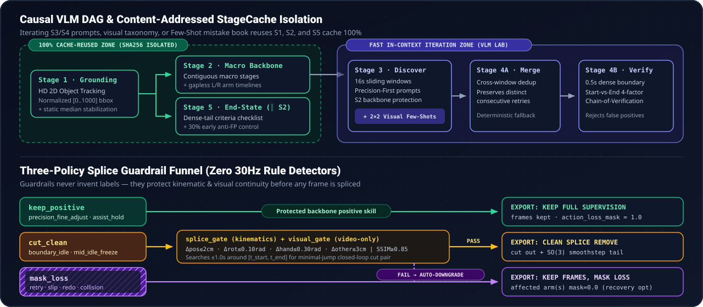

<p align="center">
  
</p>

<p align="center">
  <a href="LICENSE"></a>
  <a href="pyproject.toml"></a>
  <a href="web/package.json"></a>
  <a href="https://github.com/LVultimatefun/DDBR/actions/workflows/ci.yml"></a>
  <a href="docs/architecture.md"></a>
</p>

<p align="center">
  <strong>English</strong> · <a href="README_zh.md">Chinese</a>
  &nbsp;|&nbsp;
  <a href="#live-demo-showcase">Live Demos</a> ·
  <a href="#web-studio-gallery">Web Studio</a> ·
  <a href="#system-architecture">Architecture</a> ·
  <a href="#60-second-zero-api-key-demo-quickstart">Quickstart</a> ·
  <a href="#docker-deployment">Docker</a> ·
  <a href="#citation">Citation</a>
</p>

---

**DDBR (`robo_vlm_qc`)** — *Don't Describe Before Rule* — is a standalone, embodiment-agnostic quality-control and dataset-curation platform for robot manipulation trajectories and egocentric human-hand demonstration videos (e.g., Epic-Kitchens, Ego4D). Instead of brittle 30 Hz kinematic threshold heuristics, it runs a **causal multi-stage Vision-Language Model (VLM) DAG** paired with **lightweight splice-safety guardrails**, a **unified bilingual (`EN / ZH`) Dual-Role NLE Web Studio (`Reviewer` & `Lead`)** with **one-click VLM API/model switching** and **AI-assisted `TaskSpec` onboarding**, a **pure In-Context `VLM Lab`** improvement loop (**zero VLM SFT/DPO/LoRA fine-tuning export**), and a pluggable **3-In × 4-Out** robotics data kernel.

---

## Live Demo Showcase

### 45-Second Full-Workflow Walkthrough (Bilingual Studio · 2D Grounding · AI Task Wizard · LeRobot v3 Export)

<p align="center">
  <a href="docs/assets/studio_walkthrough_45s.mp4">
    
  </a>
</p>

<p align="center">
  <a href="docs/assets/studio_walkthrough_45s.mp4"><strong>Watch / Download Full 720p@30fps Walkthrough MP4 (42s · 1.65 MB)</strong></a> ·
  Live screen capture on open-source ALOHA data showing <strong>Dark NLE Studio</strong> (30fps BAFT 2D Grounding, PiP wrist cam, SSIM cut-safety &amp; <code>cut_clean → mask_loss</code> guardrail downgrade), instant <strong>bilingual <code>EN / ZH</code> switching + one-click <code>Model / API</code> modal</strong>, <strong>unrecognized <code>_default</code> triage → multimodal 5-frame AI TaskSpec Wizard</strong>, and <strong>transactional <code>lerobot_v3</code> export with <code>split_by_subtask</code></strong>.
</p>

Rendered directly by `robo-vlm-qc render-mp4` (`viz_mp4` 1080p@30fps Studio HUD) on open-source multi-camera bimanual ALOHA episodes from HuggingFace LeRobot ([`lerobot/aloha_static_cups_open`](https://huggingface.co/datasets/lerobot/aloha_static_cups_open) & [`lerobot/aloha_static_pro_pencil`](https://huggingface.co/datasets/lerobot/aloha_static_pro_pencil)):

### 1. Bimanual Cup Opening (`aloha_static_cups_open`) — `cut_clean` · `mask_loss` · `keep_positive`

<p align="center">
  <a href="docs/assets/demo_aloha_cups_hud.mp4">
    
  </a>
</p>

<p align="center">
  <a href="docs/assets/demo_aloha_cups_hud.mp4"><strong>Watch / Download Full 720p@30fps MP4 (825 KB)</strong></a> ·
  Shows <code>HEAD + L-WRIST + R-WRIST</code> mosaic, live 2D object grounding, leading <code>boundary_idle</code> (<code>cut_clean</code>), right-arm <code>missed_grasp_retry</code> (hatched <code>mask_loss</code>), protected <code>bimanual_assist_hold</code> (<code>keep_positive</code>), and real-time completion criteria verification.
</p>

### 2. Mid-Air Bimanual Handover (`aloha_static_pro_pencil`) — Precision Skill Protection & GT Freeze

<p align="center">
  <a href="docs/assets/demo_aloha_handover_hud.mp4">
    
  </a>
</p>

<p align="center">
  <a href="docs/assets/demo_aloha_handover_hud.mp4"><strong>Watch / Download Full 720p@30fps MP4 (741 KB)</strong></a> ·
  Demonstrates Precision-First backbone protection on slow converging mid-air transfer (<code>precision_fine_adjust</code> → <code>keep_positive</code>), synchronized 4-track timeline, and frozen <code>GT_FROZEN (HUMAN REVIEWED)</code> status.
</p>

---

## Web Studio Gallery

Single FastAPI + React 19 + TypeScript + Vite SPA serving both `Reviewer` and `Lead` workflows with **Dark & Light themes**, **live English / Chinese (`EN / ZH`) bilingual switching**, **one-click TopNav `Model / API` switching**, live SSE jobs, and strict 3-layer human editing (`qc_segments`, `success`, `macro_stages` / subtasks):

<table>
  <tr>
    <td width="50%" valign="top">
      <a href="docs/assets/studio_review_dark.png">
        
      </a>
      <br />
      <strong>Dual-Role NLE Review Studio (Dark)</strong> — Synchronized multi-cam PiP player with per-object 2D Grounding toggles &amp; custom-object S1 rerun, redesigned Layer 2 Success panel (full-width multi-line evidence, 3-state pills, <code>Now</code> stamping, Verdict sync), Subtask Stages with cross-track QC magnetic snap &amp; 1-click VLM subtask inference, and quick Export menu.
    </td>
    <td width="50%" valign="top">
      <a href="docs/assets/studio_vlm_lab.png">
        
      </a>
      <br />
      <strong>VLM Lab (Pure In-Context Loop)</strong> — Automated 6-bucket diagnosis, 2×2 visual Few-Shot mistake book, unknown triage, versioned config diff/rollback, and GT regression sandbox.
    </td>
  </tr>
  <tr>
    <td width="50%" valign="top">
      <a href="docs/assets/studio_queue_light.png">
        
      </a>
      <br />
      <strong>Episode Queue &amp; Batch Orchestration (Light)</strong> — Dark/Light &amp; <code>EN / ZH</code> toggles, SQLite claim leases, cut/mask telemetry, batch <strong>Export Selected</strong> shortcut, faceted filters, and read-only directory ingest.
    </td>
    <td width="50%" valign="top">
      <a href="docs/assets/studio_export.png">
        
      </a>
      <br />
      <strong>4-Out Transactional Export Center</strong> — Atomic <code>_staging → rename</code> bundles across <code>lerobot_v3</code> (native-dim preservation + optional <code>split_by_subtask</code>), <code>h5_clean</code>, <code>zero_copy_index</code>, and <code>viz_mp4</code> with 3 training recipes and 0-match status hints.
    </td>
  </tr>
</table>

---

## System Architecture

<p align="center">
  
</p>

### Causal VLM DAG, `StageCache` Isolation & Splice Guardrails

<p align="center">
  
</p>

See [`docs/architecture.md`](docs/architecture.md) for architectural decisions (D1–D8), Pydantic v2 schemas, SQLite WAL tables, cache-key isolation formulas, guardrail thresholds, and exporter specifications.

---

## Key Capabilities

- **3-In Pluggable Read-Only I/O Kernel ([`robo_vlm_qc/io/`](robo_vlm_qc/io/))**: Strictly read-only ingestion across `h5_raw_v3` (5-stream 30 Hz sync, Slerp, tactile repair, SBS L/R crop), `lerobot` (v2/v3 Parquet + MP4, preserving native `state_names` / `action_names`), and `video_dir` (`kinematics=None`, including egocentric human-hand videos), paired with camera-role-adaptive 2×2 / 1×2 tiling (`wrist_2x2`, `torso_head_2x2`, `single_1x2`).
- **Causal VLM DAG, Token-Saving Engine, Anti-Jitter BAFT 2D Tracking & Segment-Synced Subtasks ([`robo_vlm_qc/vlm/`](robo_vlm_qc/vlm/), [`robo_vlm_qc/guardrail/`](robo_vlm_qc/guardrail/))**:
  - Multi-provider `httpx` `VlmClient` (OpenAI-compatible, DashScope, native Gemini `/v1beta` w/ per-stage `image_detail` / `MEDIA_RESOLUTION_{LOW,HIGH}` & low-detail-calibrated blind-node token-density guard, local vLLM) with `VlmCircuitBreaker`, automatic log/error secret redaction, prefix-cache `cached_tokens` telemetry & discounted `(stage, model)` USD pricing, stage-level heterogeneous model routing, provider-isolated `StageCache` (`S1` decoupled so `S1`-only reruns preserve `S2`–`S5` cache), pre-dispatch cost estimation (`POST /api/jobs/estimate`), and cooperative mid-flight VLM cancellation (~1 ms socket abort + atomic SSE status rollback).
  - **Token-Saving Pipeline Optimizations**: Combines per-stage `image_detail` (`s1_pass0`/`s2`: `low`, `s1`: `high`, `s3`–`s5`: `auto`), deterministic downsampled grayscale MAD static-frame deduplication (`vlm/frame_dedup.py`) in S2/S3 with exact skipped-span notes, S3 adaptive step sampling (`0.8s` near stage transitions/edges vs `1.4s` inside calm interiors), short-episode S1 Pass-0 + Batch-0 1-call merge, static `system`-prefix hoisting for provider prompt caching (`cached_tokens`), S4B dynamic frame capping (`4..18`), and 1-click **Fast / Balanced / High-Precision** cost-tier routing presets.
  - **S1 Open-Vocabulary Object Locking & Anti-Jitter BAFT**: Runs Pass-0 canonical object discovery on 4–6 overview frames when `grounding_objects` is empty (merged into Batch 0 on short episodes), direct 7-frame ORB+RANSAC fixed-vs-moving camera detection, Batch-0 `ref_frame_0` spatial anchoring + phantom hallucination guard + cross-batch static consensus, custom-object S1 reruns from Studio, and 480px BAFT tracking with hallucinated-anchor NCC rejection, single-switchpoint monotonic DP, flow-consistent adaptive anchor weighting, and moderate/2-frame jitter rejection.
  - **Subtask Sync, Kinematics Telemetry & Stage Short-Circuits (`S2`–`S5`)**: Injects S1 object state transitions into S2 (`MacroStage.instruction`) with on-demand **Infer Subtasks** (`POST /api/episodes/{id}/infer-subtasks`) and `±0.08s` magnetic QC snap; injects objective 30 Hz kinematics summaries into S3/S4B (omitted cleanly on pure-video `video_dir`); skips redundant S4A merges & kinematics-verified edge `boundary_idle` S4B calls; and pairs S5 `START_vs_END` high-res comparison with sequential on-demand `s5_control` checks (cutting S5 calls in half on failure/unsure episodes).
  - Lightweight guardrails (arm-aware `hallucination`, edge-exact `splice_gate`, `visual_gate`) never invent labels — they protect continuity by auto-downgrading unsafe `cut_clean` intervals to `mask_loss`.
- **Embodiment-Agnostic Prompts & 11 Pure-Visual Labels ([`configs/labels.yaml`](configs/labels.yaml))**: Strictly visual taxonomy decoupled from splice policies, paired with Precision-First stage prompts ([`configs/prompts/`](configs/prompts/)) and task specs ([`configs/tasks/`](configs/tasks/)) compatible with both **robot arms/grippers** and **human hands / egocentric video**.
- **One-Click VLM API / Cost-Tier Switcher & Modern Bilingual Web Studio (`EN / ZH`)**: Switch provider presets (`OpenAI`, `DashScope`, `Gemini`, `Local vLLM`, `Custom`) and one-click **Fast / Balanced / High-Precision** cost-tier routing right from the TopNav `Model / API` modal (`GET/PUT /api/settings/vlm`, `POST /api/settings/vlm/test`) or `robo-vlm-qc config-vlm` CLI — API keys are written exclusively to `<workspace>/.env` (`0600`), never persisted in YAML or echoed in plaintext. The route-lazy-loaded SPA features global **`Cmd+K` / `Ctrl+K` Command Palette**, Queue URL filter sync + `J/K/X/Enter//` keyboard flow, **full-site token/cost & cache-hit telemetry** (Queue column, Pre-Dispatch `Estimate Cost` popover, Job Drawer, and Studio run-cost chip), cursor-anchored Ctrl/Alt+Wheel timeline zoom + magnetic snap guide + compact density (`Display & Shortcuts` popover), first-run onboarding empty state + shimmer skeletons, and instant **English / Chinese** switching.
- **System Operations & Media Performance**: Includes `robo-vlm-qc doctor` environment/DB/VLM diagnostics, `robo-vlm-qc gc` + automatic `PreviewCache` 10 GB LRU disk eviction, SSE-safe HTTP GZip compression, strong `ETag`/`304`/`Cache-Control` headers on `/frame` and `/preview` endpoints, composite SQLite indexes, and live streaming ingest progress.
- **Manual `_default` Task Intervention & AI-Assisted `TaskSpec` Onboarding**: Episodes whose directory or metadata names do not match an existing task fall back to `_default` and are highlighted in Queue and Review Studio with a one-click `Unrecognized (_default)` filter chip and inline/batch reassignment (`PATCH /api/episodes/{id}/task`, `POST /api/episodes/batch-task`, and `ingest --task`). Leads can launch the reusable **"+ New Task (AI)" Wizard** (`POST /api/lab/tasks/draft`) with any Chinese or English description plus 4–6 uniformly sampled keyframes from a sample episode to draft a normalized English `TaskSpec` (`goal`, `steps`, `criteria`, `task_prompt`, `grounding_objects`, and deterministically scrubbed `match`/`aliases`), review/edit every field, save via `PUT /api/lab/tasks`, and immediately reassign target episodes.
- **Single-Truth Store ([`robo_vlm_qc/store/`](robo_vlm_qc/store/))**: Authoritative Pydantic v2 schemas (`VlmRunArtifact`, `HumanReviewArtifact`, `ResolvedEpisode`) backed by SQLite WAL (`robo_vlm_qc.db`), immutable JSON artifacts (`artifacts/`), and `.history/` configuration snapshots.
- **`VLM Lab` Pure In-Context Loop ([`robo_vlm_qc/lab/`](robo_vlm_qc/lab/))**: Automated 6-bucket error diagnosis (`VLM Raw vs Human GT`), 1-click 2×2 visual/text Few-Shot mistake book injected into S3/S4, unknown anomaly triage (`merge` / `promote`), `.history/` diff & 1-click rollback, advisory LLM prompt diffs (`prompt_assist`), and GT regression eval sandbox reusing S1/S2/S5 cache 100% (**strictly In-Context — zero VLM SFT/DPO/LoRA export**).
- **4-Out Transactional Exporters ([`robo_vlm_qc/export/`](robo_vlm_qc/export/))**: Shared `PieceSlicer` (smoothstep + SO(3) geodesic tail smoothing, `is_tail`, `action_loss_mask`, `subtask_index`) and atomic `_staging → rename` exporters (`lerobot_v3`, `h5_clean`, `zero_copy_index`, `viz_mp4`) across 3 recipes (`bc_clean`, `recovery_plus`, `badcase_pairs`). `lerobot_v3` now supports adaptive **`state_schema_mode`** (`auto` preserves native dims/names for uniform LeRobot datasets like 14-D ALOHA or 7-D Franka, omits dummy 81-D zeros on pure-video `video_dir`, and unifies H5/heterogeneous mixes to canonical 81-D) plus dual subtask export (frame-level `subtask_index` + `meta/subtasks.parquet` with `instruction`, and optional **`split_by_subtask`** exporting each clean subtask span as an independent episode with `task` = subtask instruction).

---

## 60-Second Zero-API-Key Demo Quickstart

> **Zero-API-Key Demo Mode**: Want to evaluate the full Dual-Role NLE Web Studio, multi-camera playback, Queue orchestration, and `lerobot_v3` Export Center **without any external dataset downloads or VLM API keys**? The three commands below synthesize both `video_dir` and 81-D `lerobot` v3 trajectories locally, ingest them strictly read-only, and boot the Studio in under 60 seconds.

### 1. Prerequisites & Install

- **Python** `>= 3.12`
- **FFmpeg** (`ffmpeg` and `ffprobe` on `PATH`)
- **Node.js** `>= 22` and `npm` (required once to build the Web Studio frontend)

```bash
git clone https://github.com/LVultimatefun/DDBR.git
cd DDBR

# Install Python package + CLI (`robo-vlm-qc`)
pip install -e ".[dev]"

# Build Web Studio frontend bundle (`web/dist/`)
cd web && npm ci && npm run build && cd ..
```

### 2. One-Command Pre-Annotated Demo & Launch Studio (Zero API Key)

```bash
# Generate 2 multi-camera video_dir episodes + 1 LeRobot v3 episode, ingest read-only,
# AND seed realistic offline VLM runs (dense 2D tracks, macro stages, guardrail downgrade, cost telemetry)
python scripts/generate_demo_dataset.py --out ./demo_data --with-sample-run --workspace ./workspace

# Launch Dual-Role Studio locally on 127.0.0.1:8000 (unauthenticated loopback dev mode)
robo-vlm-qc -w ./workspace serve --no-auth
```

*(Prefer starting from raw unannotated episodes? Omit `--with-sample-run` and run `robo-vlm-qc -w ./workspace ingest --data ./demo_data`.)*

Open `http://127.0.0.1:8000` in your browser to immediately explore the Queue (with `⌘K` palette, `Tokens / Cost` telemetry, and `Estimate Cost`), pre-annotated multi-camera Review Studio (with dense 2D grounding, run-cost breakdown, and 4-track timeline), Export Center, and `VLM Lab`. You can also run `robo-vlm-qc -w ./workspace doctor` to verify your toolchain/DB/VLM setup and `robo-vlm-qc -w ./workspace gc --dry-run` to inspect preview cache usage.

> **Security Note**: `robo-vlm-qc serve` binds `127.0.0.1` by default and requires explicit tokens (`--reviewer-token` / `--lead-token` or `ROBO_VLM_QC_*_TOKEN`) unless `--no-auth` is passed. For shared LAN or Docker deployments, always configure distinct tokens, `--allowed-data-roots`, and `--cors-origin` / `ROBO_VLM_QC_CORS_ORIGINS`.

---

## Running the Full VLM QC & Export Pipeline

### 1. Configure VLM API & Provider Preset (One-Click Web UI, CLI, or YAML)

Choose any of three ways to configure or swap your VLM model/API:

- **Option A — Web Studio One-Click Modal (Recommended)**: Launch Studio as Lead, click **`Model / API`** in the top navigation bar, pick a preset (`OpenAI`, `DashScope`, `Gemini`, `Local vLLM`, or `Custom`), paste your Base URL & API key (saved securely to `<workspace>/.env` with `0600` permissions), set a global model or per-stage routing (`S1`–`S5`), and click **Test Connection**.
- **Option B — One-Line CLI (`config-vlm`)**:
  ```bash
  robo-vlm-qc -w ./workspace config-vlm \
    --preset dashscope \
    --api-key "$DASHSCOPE_API_KEY" \
    --model qwen-vl-max \
    --test
  ```
- **Option C — Manual `.env` + YAML Preset**:
  [`configs/default.yaml`](configs/default.yaml) defaults to an OpenAI-compatible endpoint (`https://api.openai.com/v1`, `OPENAI_API_KEY`, `gpt-4o`, `thinking: false`, `thinking_mode: auto`). Ready-to-use provider presets live in [`configs/presets/`](configs/presets/):

| Preset File | Provider | Default Model | API Key Env | Thinking Mode |
| :--- | :--- | :--- | :--- | :--- |
| [`configs/presets/openai.yaml`](configs/presets/openai.yaml) | `openai_compat` | `gpt-4o` | `OPENAI_API_KEY` | `disabled` (`thinking: false`) |
| [`configs/presets/dashscope.yaml`](configs/presets/dashscope.yaml) | `openai_compat` | `qwen-vl-max` | `DASHSCOPE_API_KEY` | `dashscope` (`thinking: true`) |
| [`configs/presets/gemini.yaml`](configs/presets/gemini.yaml) | `gemini` | `gemini-2.5-pro` | `GEMINI_API_KEY` | `auto` (`thinking: true`) |
| [`configs/presets/vllm.yaml`](configs/presets/vllm.yaml) | `openai_compat` | `Qwen/Qwen2.5-VL-72B-Instruct` | `VLLM_API_KEY` | `disabled` (`thinking: false`) |

```bash
cp .env.example .env
mkdir -p ./workspace/configs_override
cp configs/presets/gemini.yaml ./workspace/configs_override/default.yaml
```

### 2. Run VLM DAG, Review, Evaluate, and Export

```bash
# 1. Run causal VLM DAG (S1 -> S2||S5 -> S3 -> S4A -> S4B) + light guardrails
robo-vlm-qc -w ./workspace run-vlm --workers 4

# 2. Launch authenticated Dual-Role Studio (EN / ZH switchable in top nav)
robo-vlm-qc -w ./workspace serve \
  --reviewer-token "$ROBO_VLM_QC_REVIEWER_TOKEN" \
  --lead-token "$ROBO_VLM_QC_LEAD_TOKEN" \
  --allowed-data-roots ./demo_data

# 3. (After Lead freezes GT episodes) Run VLM Lab GT regression sandbox
robo-vlm-qc -w ./workspace eval --few-shot --json

# 4. Export curated training datasets (auto-preserves native LeRobot dims / skips dummy zeros on video_dir)
robo-vlm-qc -w ./workspace export \
  --format lerobot_v3 \
  --recipe bc_clean \
  --status approved --status gt_frozen --status reviewed \
  --state-schema-mode auto \
  --out ./exports/lerobot_bc_clean

# 4b. Optional: split clean pieces into per-subtask LeRobot episodes (task = subtask instruction)
robo-vlm-qc -w ./workspace export \
  --format lerobot_v3 \
  --recipe bc_clean \
  --status approved --status gt_frozen --status reviewed \
  --split-by-subtask \
  --out ./exports/lerobot_subtasks

# 5. Render standalone 1080p@30fps Studio HUD visualization MP4s
robo-vlm-qc -w ./workspace render-mp4 --all-ready
```

---

## Docker Deployment

Build and run the complete FastAPI + React Studio stack (multi-stage Node 22 + Python 3.12 + FFmpeg) via [`Dockerfile`](Dockerfile) and [`docker-compose.yml`](docker-compose.yml):

```bash
cp .env.example .env
# Edit .env to set ROBO_VLM_QC_REVIEWER_TOKEN, ROBO_VLM_QC_LEAD_TOKEN, and your VLM API key

mkdir -p workspace data
docker compose up --build
```

The Compose stack mounts `./workspace` (read-write) and `./data` (read-only, enforced by `--allowed-data-roots /data`), reads `.env`, and serves Studio on `http://localhost:8000`.

---

## Core Concepts Summary

| Dimension | Design Summary |
| :--- | :--- |
| **3-In Adapters** | `h5_raw_v3` (5-stream 30 Hz sync, Slerp, tactile repair, SBS L/R crop, O(K) JPEG), `lerobot` (v2/v3 Parquet + MP4), `video_dir` (pure-video `kinematics=None`). |
| **4-Out Exporters** | `lerobot_v3` (adaptive `state_schema_mode`: preserves native dims/names for uniform LeRobot datasets, skips dummy zeros for pure-video `video_dir`, or canonical 81-D for H5/mixed; CFR MP4s, `subtasks.parquet` with `instruction`, optional `split_by_subtask` per-subtask episodes, `info.json`, `stats.json`), `h5_clean` (sliced raw streams + `/qc/*`), `zero_copy_index` (`qc_index.parquet`, `manifest.jsonl`, `subtasks.json`), `viz_mp4` (1920×1080@30fps HUD). |
| **3 Export Recipes** | `bc_clean` (passed episodes, positive segments + safe `cut_clean` removed, `mask_loss` masked to `0.0`), `recovery_plus` (also unmasks `recovery` segments), `badcase_pairs` (badcase/terminal_fail + context windows for contrast/failure analysis). |
| **11 Pure-Visual Labels** | `boundary_idle`, `mid_idle_freeze`, `missed_grasp_retry`, `object_slip_recovery`, `placement_redo`, `hesitation_oscillation`, `collision_or_knock`, `precision_fine_adjust`, `bimanual_assist_hold`, `terminal_failure`, `unknown_anomaly`. |
| **Example Tasks** | [`_default.yaml`](configs/tasks/_default.yaml) (embodiment-agnostic: robot arms/grippers & human hands), [`pick_and_place.yaml`](configs/tasks/pick_and_place.yaml), [`bimanual_handover.yaml`](configs/tasks/bimanual_handover.yaml). |
| **Causal DAG & Token Engine** | `S1` (Pass-0 Discovery + Short-Episode Batch-0 Merge + Custom Objects + Temporal-Batched 2D Grounding + Anti-Jitter BAFT) → `S2 ∥ S5` (Low-detail + Static-Frame MAD Dedup Subtask Stages w/ VLA `instruction` + `/infer-subtasks` ∥ Dense-Tail Success + 30% Anti-FP Control) → `S3` (Adaptive Step + Static Dedup + S2 Protection + Few-Shot) → `S4A/S4B` (Merge + Dynamic-Frame CoV Diff). Prefix-cache `cached_tokens` telemetry, Fast/Balanced/High-Precision cost tiers, `POST /api/jobs/estimate`, `StageCache` isolation, and cooperative ~1 ms socket cancel. |
| **Dual-Role Studio & UX** | Lazy-loaded, modularized SPA (`Reviewer` & `Lead`) with Dark/Light themes, `EN / ZH` i18n, global **`Cmd+K` Command Palette**, Queue URL sync + `J/K/X/Enter//` flow, full-site cost telemetry & pre-dispatch `Estimate Cost`, `Model / API` cost-tier switcher (`0600` `.env`), `_default` task intervention + AI `TaskSpec` wizard, cursor-anchored timeline zoom + magnetic snap + compact density, onboarding empty state, and strict 3-layer editing (`qc_segments`, `success`, `macro_stages`). |
| **System Ops & Perf** | `robo-vlm-qc doctor` diagnostics, `robo-vlm-qc gc` + automatic `PreviewCache` 10 GB LRU eviction, SSE-safe HTTP GZip middleware, strong `ETag`/`304`/`Cache-Control` media caching, composite SQLite indexes, and streaming ingest progress. |
| **`VLM Lab` In-Context Loop** | `GT Freeze` → `Diagnosis (6 buckets)` → `2×2 Visual Few-Shot` / `Unknown Triage` / `Versioned Taxonomy` → `GT Sandbox Eval` → `Promote` (with `.history/` backup). **Zero VLM SFT/DPO/LoRA export.** |

---

## Documentation & Community

- **[`docs/architecture.md`](docs/architecture.md)** — System architecture decisions, visual diagrams, Pydantic v2 & SQLite WAL schemas, `StageCache` isolation, guardrail thresholds, `PieceSlicer`, and 4 exporters.
- **[`docs/operations.md`](docs/operations.md)** — Complete CLI reference, YAML configs & provider presets, canonical FastAPI REST/SSE & RBAC contracts, Dual-Role Studio workflow, and `VLM Lab` In-Context SOP.
- **[`AGENTS.md`](AGENTS.md)** — Repository architecture map, dev/test/build toolchain, data-safety & architectural redlines, and Living Documentation Rules.
- **[`CONTRIBUTING.md`](CONTRIBUTING.md)** — Development setup, testing guide, and pull request checklist.
- **[`SECURITY.md`](SECURITY.md)** — Security policy and deployment hardening guidelines.
- **[`CODE_OF_CONDUCT.md`](CODE_OF_CONDUCT.md)** — Community standards (Contributor Covenant v2.1).
- **[`LICENSE`](LICENSE)** — Apache License 2.0.

---

## Citation

If you find **DDBR (`robo_vlm_qc`)** useful in your robotics dataset curation, VLA training pipeline, or embodied AI research, please cite:

```bibtex
@software{ddbr_robo_vlm_qc_2026,
  title        = {DDBR (robo\_vlm\_qc): Splice-Safe VLM Trajectory QC and NLE Studio for Embodied AI},
  author       = {DDBR Contributors},
  year         = {2026},
  url          = {https://github.com/LVultimatefun/DDBR},
  license      = {Apache-2.0}
}
```
