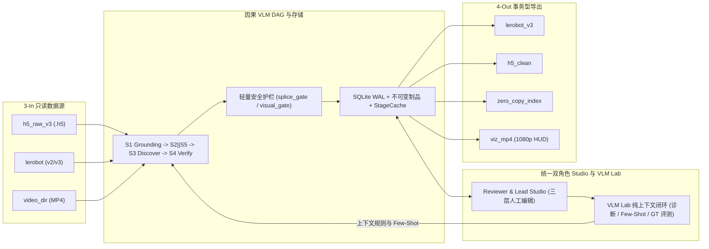

# `robo_vlm_qc`

**原生 VLM 具身轨迹质检、双角色人工审核与多格式机器人数据平台**

[](LICENSE)
[](pyproject.toml)
[](web/package.json)
[](https://github.com/LVultimatefun/DDBR/actions/workflows/ci.yml)

[English](README.md) | 简体中文

---

`robo_vlm_qc` 是一个独立、跨构型的具身操作轨迹质检与训练数据策展平台。平台彻底摒弃脆弱的 30 Hz 运动学规则阈值检测器，采用**因果多阶段视觉语言模型（VLM）DAG** 结合**轻量级切段安全护栏**、**统一双角色 Web Studio（`Reviewer` 与 `Lead`）**、**纯上下文（In-Context）`VLM Lab` 迭代闭环**（**不包含任何 VLM SFT/DPO/LoRA 微调导出**），以及可插拔的 **3-In × 4-Out** 数据 I/O 架构。

---

## 核心特性

- **3-In 可插拔只读 I/O 内核（[`robo_vlm_qc/io/`](robo_vlm_qc/io/)）**：严格只读接入 3 种内置 `InputAdapter`（`h5_raw_v3`、`lerobot` v2/v3、`video_dir` 纯视频无运动学模式），抽象统一 `MediaSource` 与可选 `KinematicsTrack`，并支持按相机角色自适应拼图（`wrist_2x2`、`torso_head_2x2`、`single_1x2`）。
- **因果 VLM DAG 与轻量护栏（[`robo_vlm_qc/vlm/`](robo_vlm_qc/vlm/)、[`robo_vlm_qc/guardrail/`](robo_vlm_qc/guardrail/)）**：基于 `httpx` 的多提供商 `VlmClient`（OpenAI 兼容接口、DashScope、Gemini、本地 vLLM），支持按阶段路由模型、动态时长 Token 预算、内容寻址 `StageCache`（`stage_cache/<sha256[:2]>/<sha256>.json`），以及三级并发 DAG：`S0 → S1 → (S2 ∥ S5) → S3 → S4A → S4B → Guardrail → Store`。轻量护栏（`hallucination`、`splice_gate`、`visual_gate`）不主动产生标签，仅在切段跳变超限时将不安全的 `cut_clean` 自动降级为 `mask_loss`。
- **11 个纯视觉核心标签（[`configs/labels.yaml`](configs/labels.yaml)）**：纯视觉语义分类与切段策略解耦，配合精准优先（Precision-First）阶段提示词（[`configs/prompts/`](configs/prompts/)）与通用任务模板（[`configs/tasks/`](configs/tasks/)）。
- **单一真相存储（[`robo_vlm_qc/store/`](robo_vlm_qc/store/)）**：由 Pydantic v2 强类型契约（`VlmRunArtifact`、`HumanReviewArtifact`、`ResolvedEpisode`）驱动，底层采用 SQLite WAL（`robo_vlm_qc.db`）、不可变 JSON 制品（`artifacts/`）以及 `.history/` 配置变更快照。
- **统一双角色 Studio（[`robo_vlm_qc/api/`](robo_vlm_qc/api/)、[`web/src/`](web/src/)）**：单个 FastAPI + React 19 + TypeScript + Vite 单页应用同时服务 `Reviewer` 与 `Lead`，共用同一套 `StudioPlayer`（2D Grounding 叠加画布）和 `FourTrackTimeline`。人工编辑严格限定在 3 个可编辑层（`qc_segments`、`success`、`macro_stages`），`arm_timelines`、`grounding` 与 `raw_vlm_segments` 始终保持只读。
- **`VLM Lab` 纯上下文迭代闭环（[`robo_vlm_qc/lab/`](robo_vlm_qc/lab/)）**：自动化 6 桶错因诊断（`VLM 原始输出 vs 人工 GT`）、一键 2×2 视觉/文本错题本 Few-Shot 注入 S3/S4、未知异常归类（`merge` 合并 / `promote` 晋升新标签）、带 `.history/` 差异对比与回滚的版本化配置热更新、辅助 Prompt 改写建议（`prompt_assist`），以及 100% 复用 S1/S2/S5 缓存的 GT 回归评测沙盒（**严格纯 In-Context，零 VLM SFT/DPO/LoRA 微调导出**）。
- **4-Out 事务型导出器（[`robo_vlm_qc/export/`](robo_vlm_qc/export/)）**：共享 `PieceSlicer`（Smoothstep + SO(3) 测地线尾段平滑、`is_tail`、`action_loss_mask`、`subtask_index`、标准 81 维运动学布局）与原子 `_staging → rename` 导出器（`lerobot_v3`、`h5_clean`、`zero_copy_index`、`viz_mp4`），支持 3 种训练配方（`bc_clean`、`recovery_plus`、`badcase_pairs`）。

---

## 系统架构概览



完整系统设计、Pydantic 模型定义、缓存隔离策略与导出协议请参阅 [`docs/architecture.md`](docs/architecture.md)。

---

## 30 秒合成 Demo 快速体验

无需外部数据集或 API Key，即可在本地完整体验数据接入与双角色 Studio 界面：

### 1. 环境准备与安装

- **Python** `>= 3.12`
- **FFmpeg**（`PATH` 中需包含 `ffmpeg` 与 `ffprobe`）
- **Node.js** `>= 22` 与 `npm`（首次构建 Web Studio 前端所需）

```bash
git clone https://github.com/LVultimatefun/DDBR.git
cd DDBR

# 安装 Python 包及命令行工具 (`robo-vlm-qc`)
pip install -e ".[dev]"

# 构建 Web Studio 前端静态资源 (`web/dist/`)
cd web && npm ci && npm run build && cd ..
```

### 2. 生成合成演示数据、入库并启动 Studio

```bash
# 生成 2 条多相机 video_dir 演示轨迹 + 1 条含 81 维运动学的 LeRobot v3 轨迹
python scripts/generate_demo_dataset.py --out ./demo_data

# 以严格只读方式扫描并注册到本地工作区
robo-vlm-qc -w ./workspace ingest --data ./demo_data

# 在本机 127.0.0.1:8000 启动双角色 Studio（本地免令牌开发模式）
robo-vlm-qc -w ./workspace serve --no-auth
```

在浏览器访问 `http://127.0.0.1:8000` 即可体验任务队列、多视角审核 Studio、数据导出与 `VLM Lab`。

> **安全提示**：`robo-vlm-qc serve` 默认仅监听 `127.0.0.1`，除非显式传入 `--no-auth`，否则必须提供 `--reviewer-token` / `--lead-token`（或设置 `ROBO_VLM_QC_REVIEWER_TOKEN` / `ROBO_VLM_QC_LEAD_TOKEN`）。在局域网或 Docker 部署时，请务必配置独立令牌、`--allowed-data-roots` 及 `--cors-origin` / `ROBO_VLM_QC_CORS_ORIGINS`。

---

## 完整 VLM 质检与导出流程

### 1. 配置密钥与模型预设

复制 [`.env.example`](.env.example) 为 `.env` 并填写对应 API Key：

```bash
cp .env.example .env
# 编辑 .env，填写 OPENAI_API_KEY 或下方其他模型提供商密钥
```

[`configs/default.yaml`](configs/default.yaml) 默认采用通用 OpenAI 兼容端点（`https://api.openai.com/v1`、`OPENAI_API_KEY`、`gpt-4o`、`thinking: false`、`thinking_mode: auto`）。开箱即用的提供商预设位于 [`configs/presets/`](configs/presets/)：

| 预设文件 | 提供商类型 | 默认模型 | 密钥环境变量 | 思考模式 |
| :--- | :--- | :--- | :--- | :--- |
| [`configs/presets/openai.yaml`](configs/presets/openai.yaml) | `openai_compat` | `gpt-4o` | `OPENAI_API_KEY` | `disabled` (`thinking: false`) |
| [`configs/presets/dashscope.yaml`](configs/presets/dashscope.yaml) | `openai_compat` | `qwen-vl-max` | `DASHSCOPE_API_KEY` | `dashscope` (`thinking: true`) |
| [`configs/presets/gemini.yaml`](configs/presets/gemini.yaml) | `gemini` | `gemini-2.5-pro` | `GEMINI_API_KEY` | `auto` (`thinking: true`) |
| [`configs/presets/vllm.yaml`](configs/presets/vllm.yaml) | `openai_compat` | `Qwen/Qwen2.5-VL-72B-Instruct` | `VLLM_API_KEY` | `disabled` (`thinking: false`) |

将任一预设复制到工作区的 `<workspace>/configs_override/default.yaml` 即可启用：

```bash
mkdir -p ./workspace/configs_override
cp configs/presets/dashscope.yaml ./workspace/configs_override/default.yaml
```

### 2. 执行 VLM DAG、人工审核、回归评测与导出

```bash
# 1. 运行因果 VLM DAG (S1 -> S2||S5 -> S3 -> S4A -> S4B) 与轻量护栏
robo-vlm-qc -w ./workspace run-vlm --workers 4

# 2. 启动带角色令牌鉴权的双角色 Studio
robo-vlm-qc -w ./workspace serve \
  --reviewer-token "$ROBO_VLM_QC_REVIEWER_TOKEN" \
  --lead-token "$ROBO_VLM_QC_LEAD_TOKEN" \
  --allowed-data-roots ./demo_data

# 3. （Lead 冻结 GT 样本后）运行 VLM Lab GT 回归评测沙盒
robo-vlm-qc -w ./workspace eval --few-shot --json

# 4. 导出高质量训练数据（4 种格式 x 3 种配方）
robo-vlm-qc -w ./workspace export \
  --format lerobot_v3 \
  --recipe bc_clean \
  --out ./exports/lerobot_bc_clean

# 5. 渲染 1080p@30fps Studio HUD 质检可视化 MP4
robo-vlm-qc -w ./workspace render-mp4 --all-ready
```

---

## Docker 一键部署

通过多阶段 [`Dockerfile`](Dockerfile)（Node 22 构建前端 + Python 3.12 与 FFmpeg 运行时）及 [`docker-compose.yml`](docker-compose.yml) 启动完整服务：

```bash
cp .env.example .env
# 在 .env 中设置 ROBO_VLM_QC_REVIEWER_TOKEN、ROBO_VLM_QC_LEAD_TOKEN 以及 VLM API Key

mkdir -p workspace data
docker compose up --build
```

容器默认挂载 `./workspace`（可写工作区）与 `./data`（只读数据目录，通过 `--allowed-data-roots /data` 约束），读取 `.env`，并在 `http://localhost:8000` 提供 Studio 服务。

---

## 核心概念一览

| 维度 | 设计摘要 |
| :--- | :--- |
| **3-In 输入适配器** | `h5_raw_v3`（5 流 30 Hz 同步、Slerp、触觉断帧修复、SBS 立体裁切、O(K) JPEG 解码）、`lerobot`（v2/v3 Parquet + MP4）、`video_dir`（纯视频 `kinematics=None`）。 |
| **4-Out 导出器** | `lerobot_v3`（81 维 Parquet、可配置 `export.robot_type` 默认 `"bimanual_robot"`、CFR MP4、`subtasks.parquet`、`info.json`、`stats.json`）、`h5_clean`（切段原流 + `/qc/*`）、`zero_copy_index`（零拷贝索引 `qc_index.parquet` / `manifest.jsonl` / `subtasks.json`）、`viz_mp4`（1920×1080@30fps HUD）。 |
| **3 种训练配方** | `bc_clean`（仅成功轨迹，移除安全 `cut_clean`，`mask_loss` 置 `0.0` 掩码）、`recovery_plus`（额外放开 `recovery` 恢复段训练）、`badcase_pairs`（导出正负对比/失败上下文窗口）。 |
| **11 个纯视觉标签** | `boundary_idle`、`mid_idle_freeze`、`missed_grasp_retry`、`object_slip_recovery`、`placement_redo`、`hesitation_oscillation`、`collision_or_knock`、`precision_fine_adjust`、`bimanual_assist_hold`、`terminal_failure`、`unknown_anomaly`。 |
| **内置示例任务** | [`_default.yaml`](configs/tasks/_default.yaml)、[`pick_and_place.yaml`](configs/tasks/pick_and_place.yaml)、[`bimanual_handover.yaml`](configs/tasks/bimanual_handover.yaml)。 |
| **因果 DAG 与缓存** | `S1`（2D 目标定位）→ `S2 ∥ S5`（宏观阶段与左右臂状态 ∥ 尾段稠密成败判定与 30% 反误报对照）→ `S3`（滑窗异常发现 + S2 保护 + Few-Shot）→ `S4A/S4B`（去重合并 + 0.5s 边界精修）。修改 S3/标签/Few-Shot 时 S1/S2/S5 `StageCache` 100% 命中。 |
| **双角色三层编辑** | `Reviewer` 与 `Lead` 共用同一 `ReviewStudioPage`。人工仅编辑 `qc_segments`、`success`、`macro_stages`；`grounding`、`arm_timelines` 与 `raw_vlm_segments` 严格只读。 |
| **`VLM Lab` 上下文闭环** | `GT 冻结` → `6 桶错因诊断` → `2×2 视觉 Few-Shot` / `未知异常归类` / `版本化配置` → `GT 沙盒回归` → `一键发布`（含 `.history/` 快照回滚）。**绝不包含 VLM SFT/DPO/LoRA 微调导出。** |

---

## 文档与社区

- **[`docs/architecture.md`](docs/architecture.md)** — 系统架构决策、Mermaid 拓扑/DAG/状态机图示、Pydantic v2 与 SQLite WAL 表结构、`StageCache` 隔离、护栏阈值与导出协议。
- **[`docs/operations.md`](docs/operations.md)** — 完整 CLI 手册、YAML 配置与提供商预设、FastAPI REST/SSE 与 RBAC 契约、双角色 Studio 与 `VLM Lab` 操作指南。
- **[`AGENTS.md`](AGENTS.md)** — 仓库模块索引、开发/测试/构建工具链、数据安全与架构红线及文档同步规范。
- **[`CONTRIBUTING.md`](CONTRIBUTING.md)** — 贡献指南、测试流程与 PR 检查清单。
- **[`SECURITY.md`](SECURITY.md)** — 安全漏洞报告流程与部署加固建议。
- **[`CODE_OF_CONDUCT.md`](CODE_OF_CONDUCT.md)** — 社区行为准则（Contributor Covenant v2.1）。
- **[`LICENSE`](LICENSE)** — Apache License 2.0（`Copyright 2026 robo_vlm_qc Contributors`）。
