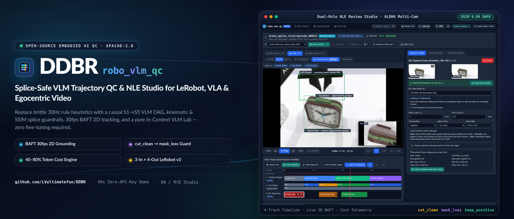
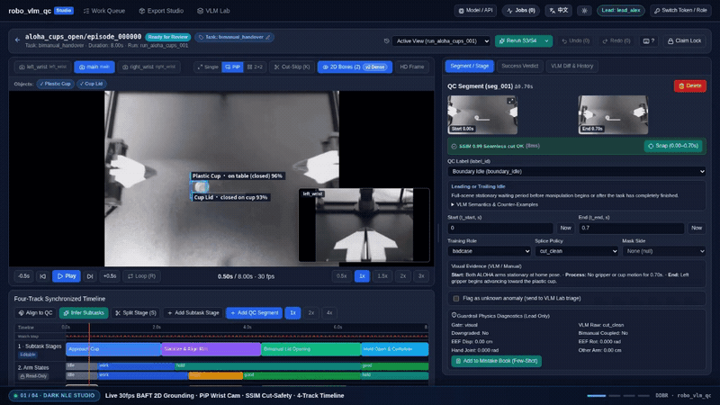
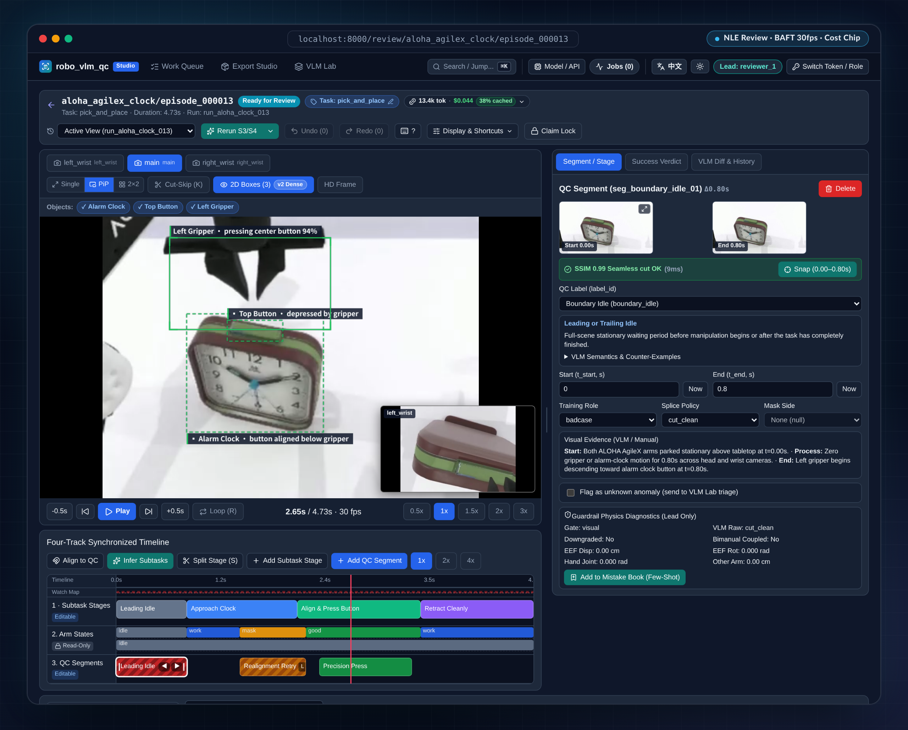
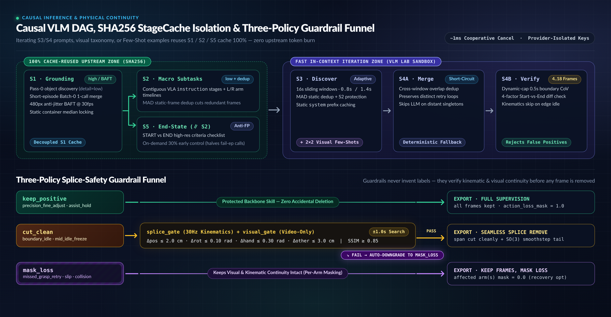
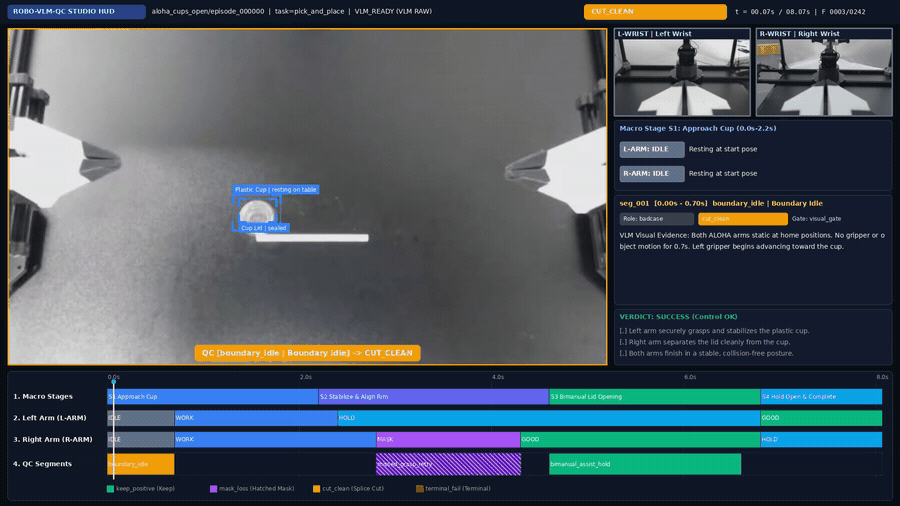

<p align="center">
  
</p>

<p align="center">
  <a href="LICENSE"></a>
  <a href="pyproject.toml"></a>
  <a href="web/package.json"></a>
  <a href="https://github.com/LVultimatefun/DDBR/actions/workflows/ci.yml"></a>
  <a href="docs/architecture.md"></a>
  <a href="#60-秒免-api-key-零门槛快速体验"></a>
</p>

<p align="center">
  <a href="README.md">English</a> · <strong>简体中文</strong>
  &nbsp;|&nbsp;
  <a href="#实操演示">演示视频</a> ·
  <a href="#为什么需要-ddbr">方案对比</a> ·
  <a href="#60-秒免-api-key-零门槛快速体验">快速体验</a> ·
  <a href="#web-studio-界面一览">Web Studio</a> ·
  <a href="#系统架构与因果-vlm-dag">系统架构</a> ·
  <a href="#token-降本引擎">降本引擎</a> ·
  <a href="#生态兼容矩阵">生态矩阵</a> ·
  <a href="#引用-citation">引用</a>
</p>

---

> **DDBR（`robo_vlm_qc`）** — *Don't Describe Before Rule* — 是一个开源、跨构型的**具身操作轨迹质检与训练数据策展平台**，原生支持双臂/单臂遥操作机器人与第一视角人类双手视频（ALOHA、Franka、双臂人形机器人、Ego4D / Epic-Kitchens）。平台彻底摒弃脆弱的 30 Hz 运动学阈值规则与会破坏策略训练的暴力硬切，采用**因果 S1→S5 VLM DAG** + **拼接安全护栏** + **中英双语双角色 NLE Web Studio** + **纯上下文 `VLM Lab` 闭环**（**零 VLM SFT/DPO/LoRA 微调导出**）+ 原子事务型 **3-In × 4-Out** LeRobot v3 数据内核。

---

## 实操演示

### 45 秒全流程实机演练

<p align="center">
  <a href="docs/assets/studio_walkthrough_45s.mp4">
    
  </a>
</p>

<p align="center">
  <a href="docs/assets/studio_walkthrough_45s.mp4"><strong>观看完整 720p@30fps 高清 MP4（42s · 1.65 MB）</strong></a> &nbsp;·&nbsp;
  开源 ALOHA 深色 NLE 审核台 · 30fps BAFT 2D 追踪 · SSIM <code>cut_clean → mask_loss</code> 护栏降级 · <code>中 / EN</code> 与 <code>Model / API</code> 一键切换 · 5 帧 AI 新任务向导 · 原子 <code>lerobot_v3</code> 按子任务导出。
</p>

---

## 为什么需要 DDBR？

遥操作与人手演示数据普遍混杂首尾静止、空抓重试与犹豫卡顿；但**直接暴力硬切坏片段会造成末端位姿/速度跳变，把 ACT、Diffusion Policy 与 VLA 策略训崩**。

| 核心能力 | 原始遥操 / 视频 | 暴力硬切 | 30 Hz 规则阈值 | **DDBR（`robo_vlm_qc`）** |
| :--- | :---: | :---: | :---: | :---: |
| **剔除无效静止与坏片段** | 否 | 是 | 仅部分 | **是（11 类纯视觉标签）** |
| **保障动作连续性（防瞬移跳变）** | 是 | **破坏连续性** | 易误切 | **不安全 `cut_clean` 自动降级为 `mask_loss`** |
| **兼容纯视频 / 人手第一视角** | 是 | 是 | **不支持（强依赖关节）** | **原生支持（`visual_gate` SSIM/L1 + 通用提示词）** |
| **保护慢速精细操作 / 协同辅助** | 是 | 极易误删 | 误报率高 | **Precision-First S2 主干保护防误删** |
| **免微调持续提准闭环** | — | — | 手工调参 | **纯 In-Context `VLM Lab`（2×2 视觉错题本 + GT 评测）** |
| **VLM 费用可控 & 本地优先** | — | — | 免费 | **40–80% 降本引擎 + 发单前毫秒级美元预估** |

<p align="center">
  
</p>

---

## 60 秒免 API Key 零门槛快速体验

无需下载外部数据集，也无需配置任何 VLM API Key。三条命令即可生成包含**稠密 2D 追踪、子任务阶段、护栏自动降级与费用明细**的本地预标注演示库，即刻体验完整 NLE Studio、全局 `⌘K` 命令面板与 `lerobot_v3` 导出中心。

**环境要求**：Python `>= 3.12`、FFmpeg（`ffmpeg` + `ffprobe`）、Node.js `>= 22`。

```bash
# 1. 克隆仓库，安装 Python CLI 并构建前端静态资源
git clone https://github.com/LVultimatefun/DDBR.git && cd DDBR
pip install -e ".[dev]" && (cd web && npm ci && npm run build)

# 2. 本地生成多相机 video_dir + 81 维 LeRobot v3 轨迹，并写入离线预标注 VLM 结果
python scripts/generate_demo_dataset.py --out ./demo_data --with-sample-run --workspace ./workspace

# 3. 启动本地双角色 Studio（浏览器打开 http://127.0.0.1:8000）
robo-vlm-qc -w ./workspace serve --no-auth
```

> **运维诊断**：随时运行 `robo-vlm-qc -w ./workspace doctor` 一键检查 Python/OpenCV/FFmpeg/数据库/VLM 状态；运行 `robo-vlm-qc -w ./workspace gc --dry-run` 预检 `PreviewCache`（默认 10 GB LRU 自动淘汰）磁盘占用。  
> **安全提示**：`serve` 默认仅监听 `127.0.0.1` 且强制鉴权（除非显式 `--no-auth`）；局域网或 Docker 部署请务必配置 `--reviewer-token` / `--lead-token`、`--allowed-data-roots` 及 `--cors-origin`。

---

## Web Studio 界面一览

单一按路由懒加载的 **FastAPI + React 19 + TypeScript + Vite** 应用，统一服务 `Reviewer` 与 `Lead` 双角色，内置**深浅双主题**、**中英双语实时切换（`中 / EN`）**、**全局 `Cmd+K` 命令面板**、**一键 `Model / API` 与成本档位切换**、SSE 异步任务流以及严格三层人工编辑（`qc_segments`、`success`、`macro_stages`）。

<table>
  <tr>
    <td width="50%" valign="top">
      <a href="docs/assets/studio_review_dark.png">
        
      </a>
      <br />
      <strong>双角色 NLE 审核 Studio（深色）</strong> — 多视角画中画同步播放与 30fps BAFT 2D 框、顶部 Token/费用与缓存命中胶囊、实时 SSIM 切段校验、指针锚定缩放 + 磁吸对齐线时间轴，以及<code>视图与快捷键</code>折叠面板。
    </td>
    <td width="50%" valign="top">
      <a href="docs/assets/studio_queue_light.png">
        
      </a>
      <br />
      <strong>全局审核队列与批量编排（浅色）</strong> — URL 筛选同步、<code>J/K/X/Enter//</code> 键盘流、<code>Tokens / Cost</code> 费用列、发单前 <code>Estimate Cost</code> 预估弹窗、<code>未识别 (_default)</code> 干预胶囊与 <code>+ 新建任务 (AI)</code> 向导。
    </td>
  </tr>
  <tr>
    <td width="50%" valign="top">
      <a href="docs/assets/studio_vlm_lab.png">
        
      </a>
      <br />
      <strong>VLM Lab（纯上下文迭代闭环）</strong> — 模块化四页签工作台：6 桶 GT 错因诊断、自动注入 S3/S4 的 2×2 视觉错题本、未知异常归类、版本化配置 Diff/一键回滚（<code>.history/</code>）与 100% 复用上游缓存的 GT 评测沙盒。
    </td>
    <td width="50%" valign="top">
      <a href="docs/assets/studio_export.png">
        
      </a>
      <br />
      <strong>4-Out 事务型导出中心</strong> — 原子 <code>_staging → rename</code> 导出 <code>lerobot_v3</code>（自适应 <code>state_schema_mode</code> + <code>split_by_subtask</code>）、<code>h5_clean</code>、<code>zero_copy_index</code> 与 <code>viz_mp4</code>，支持导出历史追溯与打包下载。
    </td>
  </tr>
</table>

---

## 系统架构与因果 VLM DAG

<p align="center">
  
</p>

<p align="center">
  
</p>

### 核心工程亮点

<table>
  <tr>
    <td width="50%" valign="top">
      <strong>1. 抗跳变 BAFT 2D 追踪（零额外 VLM 调用）</strong><br />
      Pass-0 开放词表自动发现（短轨迹合并进 Batch 0）、7 帧 ORB+RANSAC 定/动机位检测、Batch-0 首帧空间锚定，以及 480px 双向 DIS 光流 + NCC 追踪与单切换点单调 DP 抗跳变。
    </td>
    <td width="50%" valign="top">
      <strong>2. 拼接安全护栏与 VLA Subtask 同步</strong><br />
      轻量后置护栏（<code>hallucination</code>、6-DOF <code>splice_gate</code>、纯视频 <code>visual_gate</code>）绝不凭空造标签，仅在跨缝跳变超限时将 <code>cut_clean</code> 自动降级为 <code>mask_loss</code>。S2 直接产出 VLA <code>instruction</code> 子任务并支持一键重判。
    </td>
  </tr>
  <tr>
    <td width="50%" valign="top">
      <strong>3. 未识别新任务 AI TaskSpec 冷启动向导</strong><br />
      未匹配轨迹自动归入 <code>_default</code> 并提供一键筛选与批量指派；Lead 唤起 <strong>+ 新建任务 (AI)</strong> 输入中/英文描述 + 5 帧样例关键帧，即可秒级生成标准化英文 S1–S5 <code>TaskSpec</code> 并立即生效。
    </td>
    <td width="50%" valign="top">
      <strong>4. 单一真相存储与纯上下文 VLM Lab</strong><br />
      Pydantic v2 契约 + 复合索引 SQLite WAL + 不可变 JSON 制品 + SSE 安全 GZip + 媒体 <code>ETag/304</code> + 10 GB LRU 缓存淘汰。<code>VLM Lab</code> 严格通过 Prompt、标签与 2×2 Few-Shot 迭代——<strong>绝不包含 VLM SFT/DPO/LoRA 微调导出</strong>。
    </td>
  </tr>
</table>

完整架构决策（D1–D8）、Pydantic 契约、SQLite 表结构与 `StageCache` 隔离公式请参阅 [`docs/architecture.md`](docs/architecture.md)。

---

## Token 降本引擎

所有低风险降本优化均在 [`configs/default.yaml`](configs/default.yaml) 中**默认保守开启且支持独立开关**（默认模型保持通用 OpenAI `gpt-4o`），同时可在顶部 `Model / API` 弹窗一键切换三档成本预设：

| 降本杠杆 | 作用阶段 | 实现机制 | 典型收益 |
| :--- | :--- | :--- | :--- |
| **分阶段 `image_detail`** | `S1 Pass-0`、`S2` | 概览与宏观分镜使用 `detail="low"` / `MEDIA_RESOLUTION_LOW`（~85 vs 765+ tok/图）并自适应校准盲节点守卫；S1 框定保持 `high` | S2 / Pass-0 视觉 Token **-89%** |
| **MAD 静态帧去重** | `S2`、`S3` | 降采样灰度 MAD 自动跳过静止重复帧，并在 Prompt 注入精确省略时间段说明 | 高静止数据帧数 **-20% ~ -40%** |
| **自适应步长采样** | `S3` | 阶段切换与首尾边界用细步长（`0.8s`），单阶段长平稳段用粗步长（`1.4s`） | S3 消耗 **-20% ~ -30%** |
| **短轨迹 S1 单次合并** | `S1` | 关键帧数 `<= batch_size` 时将 Pass-0 物体发现与 Batch-0 框定合并为单次请求 | 短轨迹 **-1 次 VLM 往返** |
| **System 前缀缓存** | `S3`、`S4B` | 静态任务规则与标签库提升至稳定 `system` 前缀，统计 `cached_tokens` 并按 50% 缓存折价计费 | 跨窗口输入成本最高 **-50%** |
| **动态精修帧数上限** | `S4B` | 按候选段跨度动态收敛精修帧数（`4..18`），并直通运动学已验证的首尾 `boundary_idle` | S4B 消耗 **-35% ~ -60%** |
| **三档成本预设 & 预估器** | `API / UI` | 一键切换 **Fast（~0.15×）/ Balanced（~0.55×）/ High-Precision（1.0×）** + `POST /api/jobs/estimate` 零调用美元预估 | 综合账单最高 **-85%**，发单前明码标价 |

---

## 生态兼容矩阵

### 3-In 只读输入 × 4-Out 事务型导出

| 3-In 输入适配器（`robo_vlm_qc/io/`） | 核心能力 | 4-Out 导出器（`robo_vlm_qc/export/`） | 核心能力 |
| :--- | :--- | :--- | :--- |
| **`h5_raw_v3`** | 5 流 30 Hz 同步、SO(3) Slerp、触觉断帧修复、SBS 立体裁切 | **`lerobot_v3`** | 自适应 `state_schema_mode`（原生维度保留 / 纯视频跳过假零向量）+ `subtasks.parquet` + 可选 `split_by_subtask` |
| **`lerobot`（v2 / v3）** | Parquet 状态/动作 + CFR MP4，完整保留 `state_names` / `action_names` | **`h5_clean`** | 无损切段原流 HDF5，附带 `/qc/action_loss_mask` 与 `subtask_index` |
| **`video_dir`** | 多相机或单相机纯视频（`kinematics=None`，兼容人手 / Ego4D） | **`zero_copy_index`** | 轻量索引 `qc_index.parquet`、`manifest.jsonl`、`subtasks.json`（<0.1% 体积） |
| **自适应拼图器** | `wrist_2x2` · `torso_head_2x2` · `single_1x2` | **`viz_mp4`** | 1920×1080@30fps Studio HUD 质检可视化视频 |

### 开箱即用的 VLM 提供商预设

支持通过顶部 **`Model / API`** 弹窗（API Key 仅以 `0600` 权限写入 `<workspace>/.env`）、`robo-vlm-qc config-vlm` 命令行或 [`configs/presets/`](configs/presets/) 配置：

| 预设文件 | 提供商类型 | 默认模型 | 密钥环境变量 | 思考模式 |
| :--- | :--- | :--- | :--- | :--- |
| [`openai.yaml`](configs/presets/openai.yaml) | `openai_compat` | `gpt-4o` | `OPENAI_API_KEY` | `disabled`（`thinking: false`） |
| [`dashscope.yaml`](configs/presets/dashscope.yaml) | `openai_compat` | `qwen-vl-max` | `DASHSCOPE_API_KEY` | `dashscope`（`thinking: true`） |
| [`gemini.yaml`](configs/presets/gemini.yaml) | `gemini` | `gemini-2.5-pro` | `GEMINI_API_KEY` | `auto`（`thinking: true`） |
| [`vllm.yaml`](configs/presets/vllm.yaml) | `openai_compat` | `Qwen/Qwen2.5-VL-72B-Instruct` | `VLLM_API_KEY` | `disabled`（`thinking: false`） |

---

## 进阶指南（点击展开）

<details>
<summary><strong>完整 VLM 质检、回归评测与导出 CLI 流程</strong></summary>

```bash
# 1. 一行配置 VLM 提供商并测试连通性
robo-vlm-qc -w ./workspace config-vlm \
  --preset dashscope \
  --api-key "$DASHSCOPE_API_KEY" \
  --model qwen-vl-max \
  --test

# 2. 只读入库并运行因果 VLM DAG 与轻量护栏
robo-vlm-qc -w ./workspace ingest --data /path/to/lerobot_or_h5_or_videos
robo-vlm-qc -w ./workspace run-vlm --workers 4

# 3. 启动带令牌鉴权与路径沙盒的双角色 Studio
robo-vlm-qc -w ./workspace serve \
  --reviewer-token "$ROBO_VLM_QC_REVIEWER_TOKEN" \
  --lead-token "$ROBO_VLM_QC_LEAD_TOKEN" \
  --allowed-data-roots /path/to/lerobot_or_h5_or_videos

# 4. 运行 VLM Lab GT 回归评测沙盒（100% 复用 S1/S2/S5 缓存）
robo-vlm-qc -w ./workspace eval --few-shot --json

# 5. 导出高质量 LeRobot v3 训练数据（支持按 Subtask 切分为独立 Episode）
robo-vlm-qc -w ./workspace export \
  --format lerobot_v3 \
  --recipe bc_clean \
  --status approved --status gt_frozen --status reviewed \
  --state-schema-mode auto \
  --split-by-subtask \
  --out ./exports/lerobot_subtasks

# 6. 渲染 1080p Studio HUD 视频与日常运维
robo-vlm-qc -w ./workspace render-mp4 --all-ready
robo-vlm-qc -w ./workspace doctor --json
robo-vlm-qc -w ./workspace gc --max-cache-gb 10
```

</details>

<details>
<summary><strong>Docker Compose 一键部署</strong></summary>

通过多阶段 [`Dockerfile`](Dockerfile)（Node 22 + Python 3.12 + FFmpeg）及 [`docker-compose.yml`](docker-compose.yml) 启动完整服务：

```bash
cp .env.example .env
# 在 .env 中设置 ROBO_VLM_QC_REVIEWER_TOKEN、ROBO_VLM_QC_LEAD_TOKEN 及 VLM API Key
mkdir -p workspace data
docker compose up --build
```

默认挂载 `./workspace`（可写）与 `./data`（只读 `--allowed-data-roots /data`），在 `http://localhost:8000` 提供 Studio 服务。

</details>

<details>
<summary><strong>1080p Studio HUD 开源 ALOHA 双臂渲染演示</strong></summary>

以下演示由本平台 `robo-vlm-qc render-mp4` 直接基于 HuggingFace LeRobot 开源数据集（[`lerobot/aloha_static_cups_open`](https://huggingface.co/datasets/lerobot/aloha_static_cups_open) 与 [`lerobot/aloha_static_pro_pencil`](https://huggingface.co/datasets/lerobot/aloha_static_pro_pencil)）渲染：

<table>
  <tr>
    <td width="50%" valign="top">
      <a href="docs/assets/demo_aloha_cups_hud.mp4">
        
      </a>
      <br />
      <strong>双臂协同开杯盖（<code>aloha_static_cups_open</code>）</strong> — <a href="docs/assets/demo_aloha_cups_hud.mp4">720p MP4（825 KB）</a> · 展示 <code>HEAD + L/R-WRIST</code> 拼图、起始 <code>boundary_idle</code>（<code>cut_clean</code>）、右臂重试（斜线 <code>mask_loss</code>）与 <code>bimanual_assist_hold</code>（<code>keep_positive</code>）。
    </td>
    <td width="50%" valign="top">
      <a href="docs/assets/demo_aloha_handover_hud.mp4">
        
      </a>
      <br />
      <strong>双臂空中交接（<code>aloha_static_pro_pencil</code>）</strong> — <a href="docs/assets/demo_aloha_handover_hud.mp4">720p MP4（741 KB）</a> · 展示精准优先保护对慢速交接（<code>precision_fine_adjust → keep_positive</code>）的无误删保障与 <code>GT_FROZEN</code> 基准状态。
    </td>
  </tr>
</table>

</details>

<details>
<summary><strong>11 个纯视觉标签、3 种导出配方与内置任务模板</strong></summary>

- **11 个纯视觉标签（[`configs/labels.yaml`](configs/labels.yaml)）**：`boundary_idle`、`mid_idle_freeze`、`missed_grasp_retry`、`object_slip_recovery`、`placement_redo`、`hesitation_oscillation`、`collision_or_knock`、`precision_fine_adjust`、`bimanual_assist_hold`、`terminal_failure`、`unknown_anomaly`。
- **3 种训练配方**：
  - `bc_clean`：仅导出成功轨迹，移除安全 `cut_clean`（配 SO(3) 尾段平滑），`mask_loss` 置 `0.0` 掩码。
  - `recovery_plus`：额外放开 `recovery` 恢复段（`mask = 1.0`），用于训练具备纠错能力的策略。
  - `badcase_pairs`：导出失败/异常片段及前后上下文窗口，用于对比分析与失败诊断。
- **内置示例任务（[`configs/tasks/`](configs/tasks/)）**：[`_default.yaml`](configs/tasks/_default.yaml)（兼容机械臂与人类双手第一视角）、[`pick_and_place.yaml`](configs/tasks/pick_and_place.yaml)、[`bimanual_handover.yaml`](configs/tasks/bimanual_handover.yaml)。

</details>

---

## 路线图 (Roadmap)

- [x] 因果 S1–S5 VLM DAG、抗跳变 30fps BAFT 追踪，以及运动学 + 纯视觉拼接护栏
- [x] 中英双语双角色 NLE Web Studio、`Cmd+K` 命令面板、AI `TaskSpec` 向导与纯上下文 `VLM Lab`
- [x] 全链路 Token 降本引擎（`detail=low`、MAD 去重、S3 自适应步长、前缀 `cached_tokens`、三档成本预设与 `/api/jobs/estimate`）
- [x] LeRobot v3 自适应 `state_schema_mode`、`split_by_subtask`、`PreviewCache` LRU 回收、`doctor` 自检与免 API Key 演示模式
- [ ] 发布公开数据集上「原始数据 vs 暴力硬切 vs DDBR `cut_clean + mask_loss`」ACT / Diffusion Policy 训练对比基准
- [ ] Hugging Face Spaces 只读在线体验站与 RLDS / Open-X 适配器支持

---

## 文档与社区

| 文档 | 说明 |
| :--- | :--- |
| **[`docs/architecture.md`](docs/architecture.md)** | 架构决策（D1–D8）、Pydantic v2 与 SQLite WAL 表结构、`StageCache` 隔离、护栏与导出协议 |
| **[`docs/operations.md`](docs/operations.md)** | 完整 CLI 参考、YAML 预设、FastAPI REST/SSE 与 RBAC 契约、Studio 与 `VLM Lab` 操作手册 |
| **[`AGENTS.md`](AGENTS.md)** | 仓库模块索引、测试与构建工具链、数据安全红线与文档同步规范 |
| **[`CONTRIBUTING.md`](CONTRIBUTING.md)** | 本地开发环境搭建、Pytest / Vitest 测试与 PR 检查清单 |
| **[`SECURITY.md`](SECURITY.md)** · **[`CODE_OF_CONDUCT.md`](CODE_OF_CONDUCT.md)** | 安全加固规范与社区行为准则（Apache-2.0 [`LICENSE`](LICENSE)） |

### Star 增长趋势

<p align="center">
  <a href="https://star-history.com/#LVultimatefun/DDBR&Date">
    <picture>
      <source media="(prefers-color-scheme: dark)" srcset="https://api.star-history.com/svg?repos=LVultimatefun/DDBR&type=Date&theme=dark" />
      <source media="(prefers-color-scheme: light)" srcset="https://api.star-history.com/svg?repos=LVultimatefun/DDBR&type=Date" />
      
    </picture>
  </a>
</p>

---

## 引用 (Citation)

如果 **DDBR（`robo_vlm_qc`）** 对您的机器人数据清洗、VLA 训练数据策展或具身智能研究有所帮助，欢迎点亮 Star 并引用：

```bibtex
@software{ddbr_robo_vlm_qc_2026,
  title        = {DDBR (robo\_vlm\_qc): Splice-Safe VLM Trajectory QC and NLE Studio for Embodied AI},
  author       = {DDBR Contributors},
  year         = {2026},
  url          = {https://github.com/LVultimatefun/DDBR},
  license      = {Apache-2.0}
}
```
