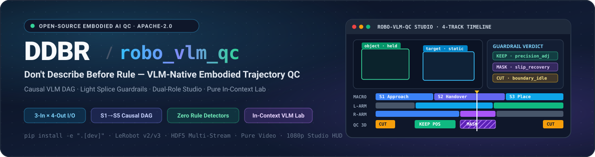
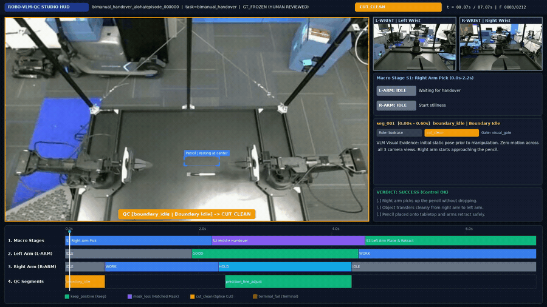
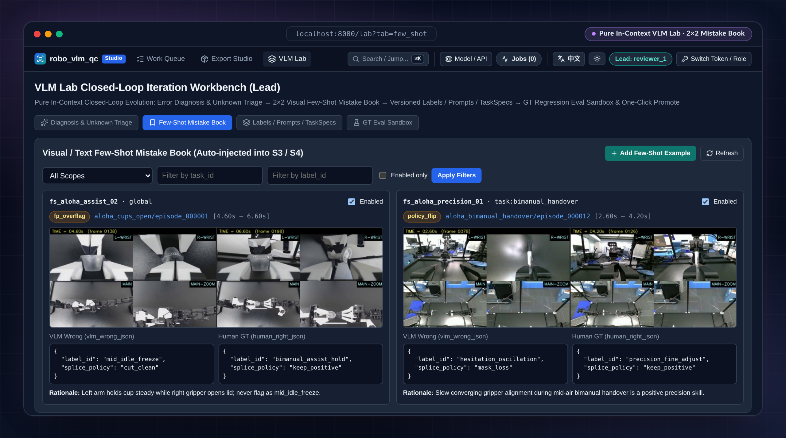
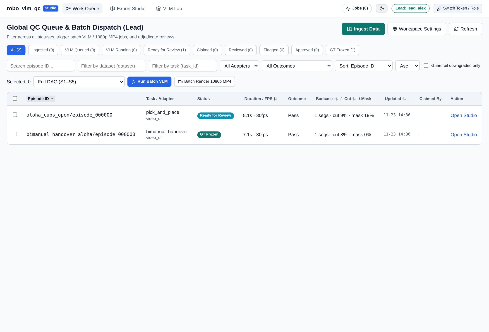
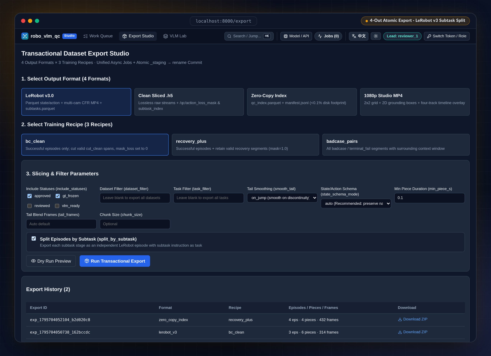
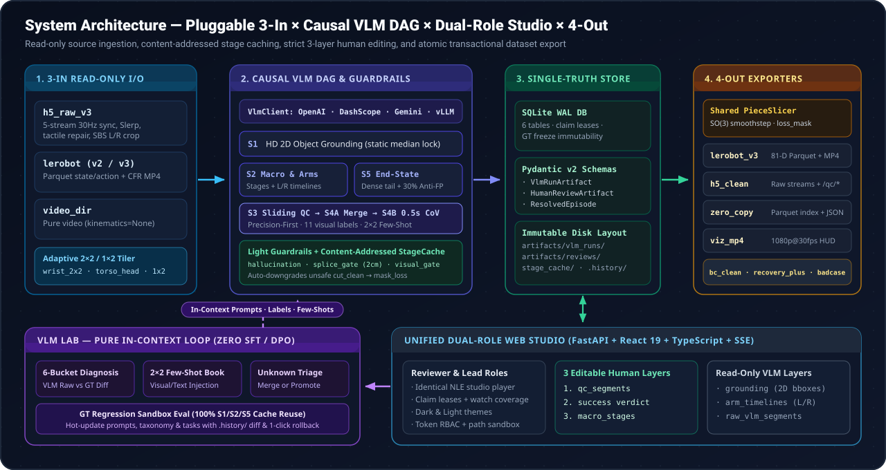
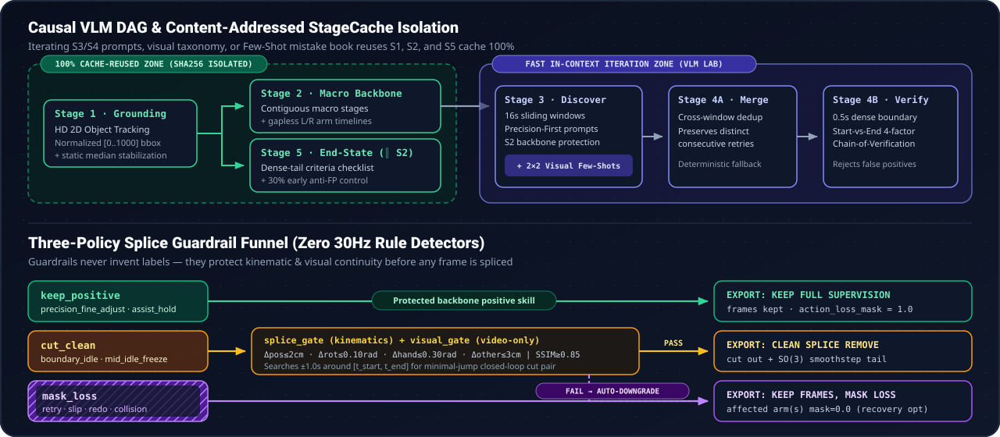

<p align="center">
  
</p>

<p align="center">
  <a href="LICENSE"></a>
  <a href="pyproject.toml"></a>
  <a href="web/package.json"></a>
  <a href="https://github.com/LVultimatefun/DDBR/actions/workflows/ci.yml"></a>
  <a href="docs/architecture.md"></a>
</p>

<p align="center">
  <a href="README.md">English</a> · <strong>简体中文</strong>
  &nbsp;|&nbsp;
  <a href="#演示视频效果展示">演示视频</a> ·
  <a href="#web-studio-界面一览">Web Studio</a> ·
  <a href="#系统架构">系统架构</a> ·
  <a href="#30-秒合成-demo-快速体验">快速体验</a> ·
  <a href="#docker-一键部署">Docker 部署</a>
</p>

---

**DDBR（`robo_vlm_qc`）** — *Don't Describe Before Rule* — 是一个独立、跨构型的具身操作轨迹质检与训练数据策展平台，原生兼容**机械臂遥操作数据**与**人类双手第一视角操作视频**（如 Epic-Kitchens、Ego4D）。平台彻底摒弃脆弱的 30 Hz 运动学规则阈值检测器，采用**因果多阶段视觉语言模型（VLM）DAG** 结合**轻量级切段安全护栏**、**支持中英双语切换（`中 / EN`）与一键替换模型 API 的统一双角色 NLE Web Studio（`Reviewer` 与 `Lead`）**、**纯上下文（In-Context）`VLM Lab` 迭代闭环**（**不包含任何 VLM SFT/DPO/LoRA 微调导出**），以及可插拔的 **3-In × 4-Out** 数据 I/O 内核。

---

## 演示视频效果展示

以下演示视频直接由本平台 `robo-vlm-qc render-mp4`（`viz_mp4` 1080p@30fps Studio HUD 渲染器）基于开源 HuggingFace LeRobot ALOHA 双臂多相机数据集（[`lerobot/aloha_static_cups_open`](https://huggingface.co/datasets/lerobot/aloha_static_cups_open) 与 [`lerobot/aloha_static_pro_pencil`](https://huggingface.co/datasets/lerobot/aloha_static_pro_pencil)）生成。

### 1. 双臂协同开杯盖（`aloha_static_cups_open`）— `cut_clean` · `mask_loss` · `keep_positive`

<p align="center">
  <a href="docs/assets/demo_aloha_cups_hud.mp4">
    
  </a>
</p>

<p align="center">
  <a href="docs/assets/demo_aloha_cups_hud.mp4"><strong>观看 / 下载完整 720p@30fps MP4（825 KB）</strong></a> ·
  展示 <code>HEAD + L-WRIST + R-WRIST</code> 多视角画中画、实时 2D 目标定位框、起始 <code>boundary_idle</code>（<code>cut_clean</code> 闭环切除）、右臂 <code>missed_grasp_retry</code>（紫色斜线 <code>mask_loss</code> 掩码）、正向 <code>bimanual_assist_hold</code>（<code>keep_positive</code> 保护）以及终态完成标准实时核验。
</p>

### 2. 双臂空中交接（`aloha_static_pro_pencil`）— 正向精细动作保护与 GT 冻结

<p align="center">
  <a href="docs/assets/demo_aloha_handover_hud.mp4">
    
  </a>
</p>

<p align="center">
  <a href="docs/assets/demo_aloha_handover_hud.mp4"><strong>观看 / 下载完整 720p@30fps MP4（741 KB）</strong></a> ·
  展示精准优先（Precision-First）主干保护对慢速收敛双臂交接动作（<code>precision_fine_adjust</code> → <code>keep_positive</code>）的无误删保护、四轨同步时间轴与 <code>GT_FROZEN (HUMAN REVIEWED)</code> 基准状态。
</p>

---

## Web Studio 界面一览

单一 FastAPI + React 19 + TypeScript + Vite 单页应用同时服务 `Reviewer` 与 `Lead` 双角色，内置**深浅双主题**、**中英双语实时切换（`中 / EN`）**、**顶部导航一键配置 VLM 模型/API**、SSE 实时异步任务流与严格三层人工编辑（`qc_segments`、`success`、`macro_stages` 子任务）：

<table>
  <tr>
    <td width="50%" valign="top">
      <a href="docs/assets/studio_review_dark.png">
        
      </a>
      <br />
      <strong>双角色 NLE 审核 Studio（深色）</strong> — 多视角 PiP 同步播放、按物体过滤 2D Grounding 画布与自定义物体重跑 S1、重做后的 Layer 2 成败判据面板（全宽多行输入、三态胶囊、<code>Now</code> 播放头打点与 Verdict 联动）、Subtask 时间轴跨轨 QC 磁吸与一键重判，以及底部快捷导出菜单。
    </td>
    <td width="50%" valign="top">
      <a href="docs/assets/studio_vlm_lab.png">
        
      </a>
      <br />
      <strong>VLM Lab（纯上下文迭代闭环）</strong> — 6 桶错因诊断、2×2 视觉错题本 Few-Shot 管理、未知异常归类、版本化配置 Diff/回滚与 GT 回归评测沙盒。
    </td>
  </tr>
  <tr>
    <td width="50%" valign="top">
      <a href="docs/assets/studio_queue_light.png">
        
      </a>
      <br />
      <strong>任务队列与批量编排（浅色）</strong> — 支持深浅双主题与 <code>中 / EN</code> 双语切换、SQLite 认领租约锁、批量<strong>导出选中项</strong>快捷入口、多维筛选与只读目录接入。
    </td>
    <td width="50%" valign="top">
      <a href="docs/assets/studio_export.png">
        
      </a>
      <br />
      <strong>4-Out 事务型导出中心</strong> — 基于原子 <code>_staging → rename</code> 支持 <code>lerobot_v3</code>（自适应保留原生维度 + 可选按 Subtask 切分独立 Episode）、<code>h5_clean</code>、<code>zero_copy_index</code>、<code>viz_mp4</code> 四种格式、三种配方与 0 条防空引导。
    </td>
  </tr>
</table>

---

## 系统架构

<p align="center">
  
</p>

### 因果 VLM DAG、`StageCache` 隔离与三策略护栏漏斗

<p align="center">
  
</p>

完整架构设计决策（D1–D8）、Pydantic v2 数据契约、SQLite WAL 表结构、缓存键隔离公式与导出器协议请参阅 [`docs/architecture.md`](docs/architecture.md)。

---

## 核心特性

- **3-In 可插拔只读 I/O 内核（[`robo_vlm_qc/io/`](robo_vlm_qc/io/)）**：严格只读接入 `h5_raw_v3`（5 流 30 Hz 同步、Slerp、触觉断帧修复、SBS 立体裁切）、`lerobot`（v2/v3 Parquet + MP4，完整保留原生 `state_names` / `action_names`）及 `video_dir`（纯视频 `kinematics=None`，兼容人手第一视角视频），支持按相机角色自适应拼图（`wrist_2x2`、`torso_head_2x2`、`single_1x2`）。
- **因果 VLM DAG、抗跳变 BAFT 2D 追踪与分割联动 Subtask（[`robo_vlm_qc/vlm/`](robo_vlm_qc/vlm/)、[`robo_vlm_qc/guardrail/`](robo_vlm_qc/guardrail/)）**：
  - 基于 `httpx` 的多提供商 `VlmClient`（OpenAI 兼容接口、DashScope、Gemini、本地 vLLM），支持按阶段路由模型、动态时长 Token 预算、内容寻址 `StageCache`（`S1` 与下游缓存解耦，仅重跑 `S1` 完整保留 `S2`–`S5` 缓存）以及协作式中途 VLM 取消（~1 ms 主动中断在途连接 + 原子化状态回滚与 SSE 实时同步）。
  - **S1 开放场景词表锁定与抗跳变 BAFT**：当任务未预设 `grounding_objects` 时，先经 Pass-0 抽帧提取 1~4 个被机械臂或人手实际交互的核心物体与目标容器词表，再下发全部并发 Batch 防止跨批换名或断轨；支持在审核页指定自定义物体重跑 S1；BAFT 升级光流一致性自适应锚点降权与中等幅度/连续双帧跳变剔除，显著抑制中小模型 2D 框周期性跳变。
  - **Subtask 同步标注（S1→S2 注入 + 基于精准分割一键重判）**：DAG 自动将 S1 物体状态摘要注入 S2 并产出可用于 VLA 训练的 `MacroStage.instruction` 指令；审核页 Track 1 升级为 `Subtask Stages`，支持 `±0.08s` 跨轨磁吸对齐 QC 分割边界，并可一键调用 **基于当前 QC 分割重判 Subtasks**（`POST /api/episodes/{id}/infer-subtasks`，完整支持 `Ctrl+Z` 撤销/重做）。
  - 轻量护栏（`hallucination`、`splice_gate`、`visual_gate`）不主动产生标签，仅在切段跳变超限时将不安全的 `cut_clean` 自动降级为 `mask_loss`。
- **机械臂与人手通用提示词 & 11 个纯视觉标签（[`configs/labels.yaml`](configs/labels.yaml)）**：纯视觉语义分类与切段策略解耦，默认任务模板（[`configs/tasks/_default.yaml`](configs/tasks/_default.yaml)）与 S1–S5 提示词（[`configs/prompts/`](configs/prompts/)）全面兼容**机械臂/夹爪**与**人类双手/第一视角演示视频**。
- **一键替换 VLM API / 模型 & 全站中英双语 Studio（`中 / EN`）**：Lead 可在顶部导航栏点击 **`Model / API`** 弹窗一键套用预设（OpenAI、DashScope、Gemini、本地 vLLM、自定义中转站）、配置 Base URL / 统一或 S1–S5 分阶段模型并实时执行 **测试连通性**（`GET/PUT /api/settings/vlm`、`POST /api/settings/vlm/test`），也可使用 `robo-vlm-qc config-vlm` 命令行一行完成切换；API Key 仅以 `0600` 权限安全写入 `<workspace>/.env`，不进 YAML 且绝不明文回传。Web Studio 全站支持顶部一键 **中 / 英双语切换**（`localStorage` 持久化）、重做后的 Layer 2 成败判据交互面板，以及审核页（单条 JSON 直下或跳往导出中心预填）与队列批量快捷导出入口。
- **单一真相存储（[`robo_vlm_qc/store/`](robo_vlm_qc/store/)）**：由 Pydantic v2 强类型契约（`VlmRunArtifact`、`HumanReviewArtifact`、`ResolvedEpisode`）驱动，底层采用 SQLite WAL（`robo_vlm_qc.db`）、不可变 JSON 制品（`artifacts/`）以及 `.history/` 配置变更快照。
- **`VLM Lab` 纯上下文迭代闭环（[`robo_vlm_qc/lab/`](robo_vlm_qc/lab/)）**：自动化 6 桶错因诊断（`VLM 原始输出 vs 人工 GT`）、一键 2×2 视觉/文本错题本 Few-Shot 注入 S3/S4、未知异常归类（`merge` / `promote`）、`.history/` 差异对比与一键回滚、辅助 Prompt 改写建议（`prompt_assist`），以及 100% 复用 S1/S2/S5 缓存的 GT 回归评测沙盒（**严格纯 In-Context，零 VLM SFT/DPO/LoRA 微调导出**）。
- **4-Out 事务型导出器（[`robo_vlm_qc/export/`](robo_vlm_qc/export/)）**：共享 `PieceSlicer`（Smoothstep + SO(3) 测地线尾段平滑、`is_tail`、`action_loss_mask`、`subtask_index`）与原子 `_staging → rename` 导出器（`lerobot_v3`、`h5_clean`、`zero_copy_index`、`viz_mp4`），支持 3 种训练配方（`bc_clean`、`recovery_plus`、`badcase_pairs`）。`lerobot_v3` 新增自适应 **`state_schema_mode`**（默认 `auto`：同维度原生 LeRobot 数据如 ALOHA 14D/Franka 7D 自动保留原维度与特征名，纯视频 `video_dir` 不写 81 维假零向量，H5/异构混合自动归一 81 维）与双模式 Subtask 导出（帧级 `subtask_index` + 含 `instruction` 列的 `meta/subtasks.parquet`，以及可选 **`split_by_subtask`** 按子任务切分为独立 Episode，使 `task` 直接填入子任务指令）。

---

## 30 秒合成 Demo 快速体验

无需外部数据集或 API Key，即可在本地完整体验数据接入与双角色 Studio 界面：

### 1. 环境准备与安装

- **Python** `>= 3.12`
- **FFmpeg**（`PATH` 中需包含 `ffmpeg` 与 `ffprobe`）
- **Node.js** `>= 22` 与 `npm`（首次构建 Web Studio 前端所需）

```bash
git clone https://github.com/LVultimatefun/DDBR.git
cd DDBR

# 安装 Python 包及命令行工具 (`robo-vlm-qc`)
pip install -e ".[dev]"

# 构建 Web Studio 前端静态资源 (`web/dist/`)
cd web && npm ci && npm run build && cd ..
```

### 2. 生成合成演示数据、入库并启动 Studio

```bash
# 生成 2 条多相机 video_dir 演示轨迹 + 1 条含 81 维运动学的 LeRobot v3 轨迹
python scripts/generate_demo_dataset.py --out ./demo_data

# 以严格只读方式扫描并注册到本地工作区
robo-vlm-qc -w ./workspace ingest --data ./demo_data

# 在本机 127.0.0.1:8000 启动双角色 Studio（本地免令牌开发模式）
robo-vlm-qc -w ./workspace serve --no-auth
```

在浏览器访问 `http://127.0.0.1:8000` 即可体验任务队列、多视角审核 Studio、数据导出与 `VLM Lab`。

> **安全提示**：`robo-vlm-qc serve` 默认仅监听 `127.0.0.1`，除非显式传入 `--no-auth`，否则必须提供 `--reviewer-token` / `--lead-token`（或设置 `ROBO_VLM_QC_REVIEWER_TOKEN` / `ROBO_VLM_QC_LEAD_TOKEN`）。在局域网或 Docker 部署时，请务必配置独立令牌、`--allowed-data-roots` 及 `--cors-origin` / `ROBO_VLM_QC_CORS_ORIGINS`。

---

## 完整 VLM 质检与导出流程

### 1. 配置 VLM API 与模型预设（Web 一键切换 / CLI / YAML 三选一）

- **方式一：Web Studio 顶部一键切换（推荐）**：以 Lead 身份打开 Studio，点击顶部导航栏 **`Model / API`**，一键选择预设（OpenAI、DashScope、Gemini、本地 vLLM 或自定义兼容端点），填写 Base URL、API Key（仅以 `0600` 权限写入 `<workspace>/.env`）以及全局或分阶段模型名，点击 **测试连通性** 即可生效。
- **方式二：CLI 一行完成切换与连通性自检（`config-vlm`）**：
  ```bash
  robo-vlm-qc -w ./workspace config-vlm \
    --preset dashscope \
    --api-key "$DASHSCOPE_API_KEY" \
    --model qwen-vl-max \
    --test
  ```
- **方式三：手动配置 `.env` 与 YAML 预设**：
  [`configs/default.yaml`](configs/default.yaml) 默认采用通用 OpenAI 兼容端点（`https://api.openai.com/v1`、`OPENAI_API_KEY`、`gpt-4o`、`thinking: false`、`thinking_mode: auto`）。开箱即用的提供商预设位于 [`configs/presets/`](configs/presets/)：

| 预设文件 | 提供商类型 | 默认模型 | 密钥环境变量 | 思考模式 |
| :--- | :--- | :--- | :--- | :--- |
| [`configs/presets/openai.yaml`](configs/presets/openai.yaml) | `openai_compat` | `gpt-4o` | `OPENAI_API_KEY` | `disabled` (`thinking: false`) |
| [`configs/presets/dashscope.yaml`](configs/presets/dashscope.yaml) | `openai_compat` | `qwen-vl-max` | `DASHSCOPE_API_KEY` | `dashscope` (`thinking: true`) |
| [`configs/presets/gemini.yaml`](configs/presets/gemini.yaml) | `gemini` | `gemini-2.5-pro` | `GEMINI_API_KEY` | `auto` (`thinking: true`) |
| [`configs/presets/vllm.yaml`](configs/presets/vllm.yaml) | `openai_compat` | `Qwen/Qwen2.5-VL-72B-Instruct` | `VLLM_API_KEY` | `disabled` (`thinking: false`) |

```bash
cp .env.example .env
mkdir -p ./workspace/configs_override
cp configs/presets/dashscope.yaml ./workspace/configs_override/default.yaml
```

### 2. 执行 VLM DAG、人工审核、回归评测与导出

```bash
# 1. 运行因果 VLM DAG (S1 -> S2||S5 -> S3 -> S4A -> S4B) 与轻量护栏
robo-vlm-qc -w ./workspace run-vlm --workers 4

# 2. 启动带角色令牌鉴权的双角色 Studio（顶部支持 中 / EN 实时切换）
robo-vlm-qc -w ./workspace serve \
  --reviewer-token "$ROBO_VLM_QC_REVIEWER_TOKEN" \
  --lead-token "$ROBO_VLM_QC_LEAD_TOKEN" \
  --allowed-data-roots ./demo_data

# 3. （Lead 冻结 GT 样本后）运行 VLM Lab GT 回归评测沙盒
robo-vlm-qc -w ./workspace eval --few-shot --json

# 4. 导出高质量 LeRobot v3 训练数据（auto 模式保留原生维度 / 纯视频不写假零向量）
robo-vlm-qc -w ./workspace export \
  --format lerobot_v3 \
  --recipe bc_clean \
  --status approved --status gt_frozen --status reviewed \
  --state-schema-mode auto \
  --out ./exports/lerobot_bc_clean

# 4b. 可选：按 Subtask 切分为独立可训练 Episode（task 直接填入子任务指令）
robo-vlm-qc -w ./workspace export \
  --format lerobot_v3 \
  --recipe bc_clean \
  --status approved --status gt_frozen --status reviewed \
  --split-by-subtask \
  --out ./exports/lerobot_subtasks

# 5. 渲染 1080p@30fps Studio HUD 质检可视化 MP4
robo-vlm-qc -w ./workspace render-mp4 --all-ready
```

---

## Docker 一键部署

通过多阶段 [`Dockerfile`](Dockerfile)（Node 22 构建前端 + Python 3.12 与 FFmpeg 运行时）及 [`docker-compose.yml`](docker-compose.yml) 启动完整服务：

```bash
cp .env.example .env
# 在 .env 中设置 ROBO_VLM_QC_REVIEWER_TOKEN、ROBO_VLM_QC_LEAD_TOKEN 以及 VLM API Key

mkdir -p workspace data
docker compose up --build
```

容器默认挂载 `./workspace`（可写工作区）与 `./data`（只读数据目录，通过 `--allowed-data-roots /data` 约束），读取 `.env`，并在 `http://localhost:8000` 提供 Studio 服务。

---

## 核心概念一览

| 维度 | 设计摘要 |
| :--- | :--- |
| **3-In 输入适配器** | `h5_raw_v3`（5 流 30 Hz 同步、Slerp、触觉断帧修复、SBS 立体裁切、O(K) JPEG 解码）、`lerobot`（v2/v3 Parquet + MP4）、`video_dir`（纯视频 `kinematics=None`）。 |
| **4-Out 导出器** | `lerobot_v3`（自适应 `state_schema_mode`：原生 LeRobot 自动保留维度与特征名、纯视频跳过假零向量、H5/混合归一 81 维；CFR MP4、含 `instruction` 的 `subtasks.parquet`、可选 `split_by_subtask` 按子任务切分独立 Episode、`info.json`、`stats.json`）、`h5_clean`（切段原流 + `/qc/*`）、`zero_copy_index`（零拷贝索引 `qc_index.parquet` / `manifest.jsonl` / `subtasks.json`）、`viz_mp4`（1920×1080@30fps HUD）。 |
| **3 种训练配方** | `bc_clean`（仅成功轨迹，移除安全 `cut_clean`，`mask_loss` 置 `0.0` 掩码）、`recovery_plus`（额外放开 `recovery` 恢复段训练）、`badcase_pairs`（导出正负对比/失败上下文窗口）。 |
| **11 个纯视觉标签** | `boundary_idle`、`mid_idle_freeze`、`missed_grasp_retry`、`object_slip_recovery`、`placement_redo`、`hesitation_oscillation`、`collision_or_knock`、`precision_fine_adjust`、`bimanual_assist_hold`、`terminal_failure`、`unknown_anomaly`。 |
| **内置示例任务** | [`_default.yaml`](configs/tasks/_default.yaml)（兼容机械臂与人类双手第一视角视频）、[`pick_and_place.yaml`](configs/tasks/pick_and_place.yaml)、[`bimanual_handover.yaml`](configs/tasks/bimanual_handover.yaml)。 |
| **因果 DAG 与缓存** | `S1`（Pass-0 开放词表锁定 + 自定义物体 + 时序分批 2D 定位 + 抗跳变 BAFT 稠密追踪：光流一致性自适应锚点降权）→ `S2 ∥ S5`（注入 S1 物体状态的 Subtask 阶段与 VLA `instruction` + 审核页按需 `/infer-subtasks` 基于精准 QC 分割重判 ∥ 尾段稠密成败判定与 30% 反误报对照）→ `S3`（滑窗异常发现 + S2 保护 + Few-Shot）→ `S4A/S4B`（去重合并 + 0.5s 边界精修）。仅重跑 `S1` 完整保留 `S2`–`S5` 缓存，修改 S3/标签/Few-Shot 时 S1/S2/S5 `StageCache` 100% 命中，并支持中途 VLM 协作取消与原子 SSE 状态回滚。 |
| **双角色 Studio 与双语** | `Reviewer` 与 `Lead` 共用同一 `ReviewStudioPage`，支持深浅双主题、实时**中英双语切换（`中 / EN`）**、TopNav 一键切换 `Model / API`（`0600` `.env` 密钥隔离）、审核页/队列快捷导出，以及严格三层编辑（`qc_segments`、`success`、`macro_stages` 子任务；`grounding`、`arm_timelines` 与 `raw_vlm_segments` 严格只读）。 |
| **`VLM Lab` 上下文闭环** | `GT 冻结` → `6 桶错因诊断` → `2×2 视觉 Few-Shot` / `未知异常归类` / `版本化配置` → `GT 沙盒回归` → `一键发布`（含 `.history/` 快照回滚）。**绝不包含 VLM SFT/DPO/LoRA 微调导出。** |

---

## 文档与社区

- **[`docs/architecture.md`](docs/architecture.md)** — 系统架构决策、可视化架构图、Pydantic v2 与 SQLite WAL 表结构、`StageCache` 隔离、护栏阈值与导出协议。
- **[`docs/operations.md`](docs/operations.md)** — 完整 CLI 手册、YAML 配置与提供商预设、FastAPI REST/SSE 与 RBAC 契约、双角色 Studio 与 `VLM Lab` 操作指南。
- **[`AGENTS.md`](AGENTS.md)** — 仓库模块索引、开发/测试/构建工具链、数据安全与架构红线及文档同步规范。
- **[`CONTRIBUTING.md`](CONTRIBUTING.md)** — 贡献指南、测试流程与 PR 检查清单。
- **[`SECURITY.md`](SECURITY.md)** — 安全漏洞报告流程与部署加固建议。
- **[`CODE_OF_CONDUCT.md`](CODE_OF_CONDUCT.md)** — 社区行为准则（Contributor Covenant v2.1）。
- **[`LICENSE`](LICENSE)** — Apache License 2.0。
