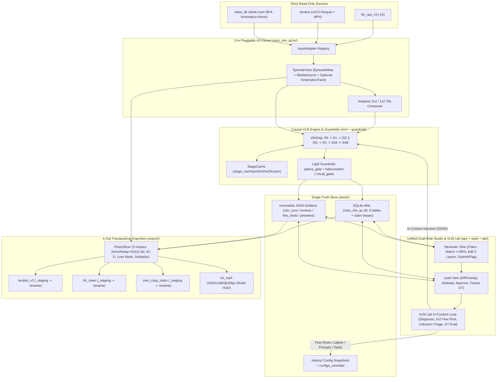
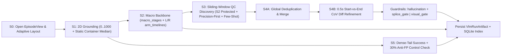
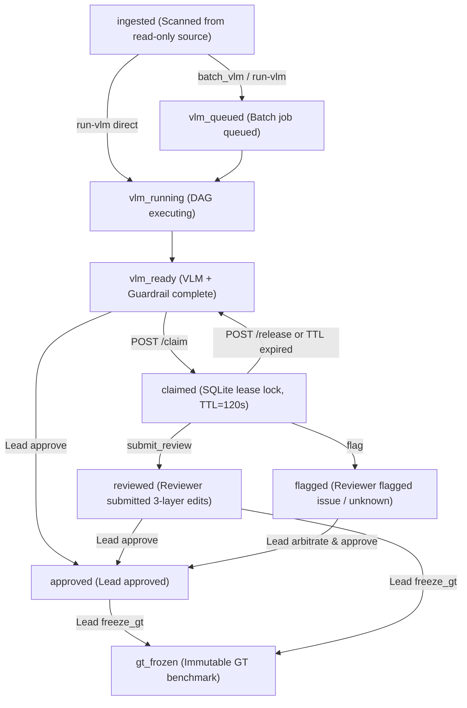

# `robo_vlm_qc` System Architecture & Contracts

> **Version**: `1.0` | **Last Synced**: `2026-11-23`  
> Authoritative architecture reference for [`robo_vlm_qc`](../README.md). See [`docs/operations.md`](operations.md) for CLI, REST/SSE API, Studio UI, and `VLM Lab` operations.

---

## 1. Eight Locked Architectural Decisions (D1–D8)

| # | Dimension | Locked Decision | Problem Solved |
| :-: | :--- | :--- | :--- |
| **D1** | **Standalone Packaging & Read-Only Sources** | Standalone Apache-2.0 Python + React platform bundling default YAML configs (`robo_vlm_qc._bundled_configs`) while keeping all `--data` sources strictly read-only. | Guarantees safe wheel distribution and zero accidental mutation of raw robotics datasets. |
| **D2** | **Role of Kinematics** | Pure-visual VLM primary labeling + pluggable light post-processing guardrails (`splice_gate` + `hallucination` when `KinematicsTrack != None`; `visual_gate` when `None`). Zero 30 Hz kinematic rule detectors. | Works across embodiments (bimanual 6/7-DoF arms, torso, chassis, or pure video) while preventing cut-induced teleportation. |
| **D3** | **Storage Foundation** | SQLite WAL (`robo_vlm_qc.db`) + immutable JSON artifacts (`artifacts/`) + `.history/` config snapshots. | Replaces fragmented multi-file annotation directories with one atomic source of truth. |
| **D4** | **`VLM Lab` Loop** | Strictly In-Context improvement loop (6-bucket diagnosis, 2×2 visual/text Few-Shot book, versioned taxonomy/prompts/tasks, GT regression sandbox). **Zero VLM SFT/DPO/LoRA export.** | Drives rapid visual QC accuracy gains through prompt, taxonomy, and Few-Shot iteration without model fine-tuning pipelines. |
| **D5** | **Dual-Role Frontend** | Single React 19 + TypeScript + Vite SPA serving `Reviewer` and `Lead` views over identical player & timeline components. | Eliminates UI drift between reviewer and lead workflows. |
| **D6** | **3-Layer Human Edits** | Humans edit ONLY `qc_segments`, `success`, and `macro_stages`. `grounding`, `arm_timelines`, and `raw_vlm_segments` are strictly read-only. | Keeps annotation fast while preserving grounding & dual-arm visual aids and Lead diffing. |
| **D7** | **3×4 I/O Matrix** | Pluggable `InputAdapter` (`h5_raw_v3`, `lerobot`, `video_dir`) × `OutputExporter` (`lerobot_v3`, `h5_clean`, `zero_copy_index`, `viz_mp4`) across 3 recipes (`bc_clean`, `recovery_plus`, `badcase_pairs`). | Decouples format serialization from core VLM QC, human review, and trajectory slicing logic. |
| **D8** | **Causal VLM DAG & Cache** | `S0 → S1 → (S2 ∥ S5) → S3 → S4A → S4B → Guardrail → Store`, with SHA256 `StageCache` and stage-level `stage_models` routing. | Prevents Stage 3 over-cutting via S2 backbone injection and reuses S1/S2/S5 cache at 100% during S3/label/Few-Shot iteration. |

---

## 2. System Topology, Causal VLM DAG & State Machine

### 2.1 End-to-End 3-In × DAG × Store × Studio × Lab × 4-Out Pipeline



### 2.2 Causal VLM DAG Execution Topology



### 2.3 Episode Status State Machine (`EpisodeStatus`)



---

## 3. Authoritative Pydantic v2 Schemas & SQLite WAL Store

### 3.1 Three-Layer Domain Models (`robo_vlm_qc/models/`)

All models enforce `ConfigDict(extra="forbid")` and use clean language-neutral field names (`name`, `title`, `label`) while accepting legacy `*_zh` input keys via a `mode="before"` normalization validator for backward compatibility with older JSON/YAML files. Abolished rule fields (`long_pause`, `back_and_forth`) are explicitly rejected at validation time by `_FORBIDDEN_LEGACY_NAMES` in [`robo_vlm_qc/models/annotation.py`](../robo_vlm_qc/models/annotation.py).

1. **`VlmRunArtifact` (`models/annotation.py`)**:
   - Metadata & provenance: `run_id`, `episode_id`, `created_at`, `is_eval_sandbox`, `config_fingerprint` (`ConfigFingerprintSnapshot`), `stage_refs` (`StageRefs`), `usage` (`UsageSummary`).
   - Read-only visual & kinematic aids: `grounding` (`GroundingResult` with `[0, 1000]` normalized bboxes and `GroundingTrack.name`), `arm_timelines` (`ArmTimelines`: `left` / `right` `ArmSpan` with `state ∈ {idle, work, hold, anom, mask, good}`).
   - Editable target baselines: `macro_stages` (`list[MacroStage]` with `label` and optional `label_en`), `qc_segments` (`list[QcSegment]` with `name`), `success` (`SuccessVerdict`).
   - **`QcSegment` Triplet Consistency** (enforced by `_validate_triplet_and_span`):
     - `keep_positive`: requires `mask_side is None` and `training_role ∈ {"necessary", "recovery"}`.
     - `mask_loss`: requires `mask_side ∈ {"left", "right", "both"}` and `training_role ∈ {"badcase", "terminal_fail", "recovery"}`.
     - `cut_clean`: requires `mask_side is None` and `training_role ∈ {"badcase", "terminal_fail"}`.
     - Every segment preserves `vlm_raw_policy` alongside `guardrail` (`GuardrailReport`: `gate_type`, `passed`, `downgraded`, `downgrade_reason`, `guardrail_override`, `override_reason`, `metrics`, `opt_t_start`, `opt_t_end`).

2. **`HumanReviewArtifact` & `ReviewWritePayload` (`models/review.py`)**:
   - `ReviewWritePayload` accepts ONLY `base_run_id`, `action` (`save_draft | submit_review | flag | approve | freeze_gt`), `qc_segments`, `success`, `macro_stages`, `watch_coverage` (`WatchCoverage`), `notes`, and `flagged_reason`.
   - `_reject_readonly_layers` rejects any payload containing `grounding`, `arm_timelines`, or `raw_vlm_segments`, and `extra="forbid"` rejects unknown fields such as `author` (server derives `author` from `X-User` / auth context).
   - `HumanReviewArtifact` records immutable snapshots with computed `diff_summary` (`ReviewDiff`: `fp_deleted`, `fn_added`, `policy_flips`, `label_changes`, `boundary_nudges`, `macro_stage_edits`, `success_flipped`, `total_edits`).

3. **`ResolvedEpisode` (`models/review.py`, `frozen=True`)**:
   - The sole read view consumed by the Studio UI, `viz_mp4`, `PieceSlicer`, and `OutputExporter`s.
   - Overlays `latest_review.{qc_segments, success, macro_stages}` onto `active_vlm_run`, while preserving read-only `grounding`, `arm_timelines`, `raw_vlm_segments`, `raw_vlm_success`, and `raw_vlm_macro_stages`.

### 3.2 SQLite WAL 6-Table Schema (`robo_vlm_qc/store/db.py`)

`DatabasePool` configures `PRAGMA journal_mode = WAL`, `PRAGMA synchronous = NORMAL`, `PRAGMA foreign_keys = ON`, `PRAGMA busy_timeout = 5000`, and serializes writes via `BEGIN IMMEDIATE` under an `RLock`:

| Table | Purpose | Key Columns |
| :--- | :--- | :--- |
| `schema_migrations` | Schema version tracking (`SCHEMA_VERSION = 1`) | `version`, `applied_at` |
| `episodes` | Multi-format registry, status machine, claim lease locks, summary metrics | `episode_id` (`"<dataset>/<stem>"`), `dataset`, `task_id`, `adapter_type`, `source_uri`, `source_mtime`, `duration_s`, `fps`, `has_kinematics`, `camera_roles_json`, `meta_json`, `status`, `active_run_id`, `active_rev_id`, `claimed_by`, `claim_expires_at`, `resolved_passed`, `cut_ratio`, `mask_ratio`, `badcase_count`, `unknown_count` |
| `vlm_runs` | Multi-version VLM run & GT sandbox metadata | `run_id`, `episode_id`, `is_eval_sandbox`, `model_routing_json`, `prompt_version`, `label_version`, `task_spec_version`, `few_shot_pack_id`, `artifact_path`, `status`, `tokens_total`, `elapsed_s`, `error_message` |
| `reviews` | Full audit trail of human review snapshots | `rev_id`, `episode_id`, `base_run_id`, `author`, `role`, `action`, `artifact_path`, `diff_stats_json` |
| `few_shot_examples` | `VLM Lab` mistake book entries | `example_id`, `scope` (`global\|task:<id>\|label:<id>`), `task_id`, `label_id`, `error_type`, `episode_id`, `t_start`, `t_end`, `tile_image_path`, `vlm_wrong_json`, `human_right_json`, `rationale`, `enabled` |
| `jobs` | Async batch VLM, `render_mp4`, `export`, `eval_gt`, and `ingest` job tracking | `job_id`, `job_type`, `status`, `params_json`, `progress_done`, `progress_total`, `summary_json` |

### 3.3 Workspace On-Disk Layout

```text
<workspace>/
├── robo_vlm_qc.db                                  # SQLite WAL index database
├── stage_cache/<sha256[:2]>/<sha256>.json          # Content-addressed VLM stage cache
├── artifacts/
│   ├── vlm_runs/<dataset>/<stem>/<run_id>.json     # Immutable VlmRunArtifact JSON
│   ├── reviews/<dataset>/<stem>/<rev_id>.json      # Immutable HumanReviewArtifact JSON
│   ├── few_shots/<example_id>.jpg                  # 2x2 start-vs-end visual Few-Shot tiles
│   ├── eval_runs/<eval_id>.json                    # GT sandbox EvalRunReport JSON
│   ├── exports/<export_id>.json                    # Persisted ExportManifest JSON
│   ├── previews/<dataset>/<stem>/                  # H.264 CFR browser preview MP4 cache
│   └── unknown_triage.json                         # Triaged unknown anomaly ledger
├── configs_override/                               # Workspace-level YAML overrides
├── exports/<export_id>/                            # Atomic _staging -> rename export bundles
└── .history/<rel_parent>/<rel_stem>/<ts>_<id>.json # Pre-modification config snapshots
```

---

## 4. Pluggable 3-In I/O Kernel & Adaptive 2×2 Tiler

[`robo_vlm_qc/io/base.py`](../robo_vlm_qc/io/base.py) defines `InputAdapter`, `MediaSource`, `KinematicsTrack` (optional), `EpisodeHandle`, and `EpisodeView`. Built-in adapters are registered in priority order in [`robo_vlm_qc/io/__init__.py`](../robo_vlm_qc/io/__init__.py):

| Priority | Adapter | Source Format | Key Capabilities |
| :-: | :--- | :--- | :--- |
| `10` | `h5_raw_v3` | `raw_only_v3` `.h5` | Aligns 5 async streams (`head_rgbd`, `head_stereo`, `torso_rgbd`, `hand`, `robot`) onto common 30 Hz window; quaternion sign-continuity + Slerp; configurable `hand_a`/`hand_b` mapping; native tactile dropout repair; `3200×1296` SBS stereo L/R virtual crop; O(K) JPEG decode; thread-local `h5py` handles. |
| `20` | `lerobot` | LeRobot v2 / v3 | Parses `meta/info.json`, chunked Parquet state/action rows, and multi-cam MP4 streams or embedded images. |
| `90` | `video_dir` | Single/Multi-cam MP4 directory | Pure-video ingestion (`kinematics = None`); triggers `visual_gate` instead of kinematics guardrails. |

### Adaptive Tile Composer ([`robo_vlm_qc/io/media.py`](../robo_vlm_qc/io/media.py))

`select_tile_mode(camera_roles)` chooses the tile geometry sent to VLM stages:
- **`wrist_2x2`** (when `left_wrist` or `right_wrist` is present): `[L-WRIST | R-WRIST / MAIN | MAIN-ZOOM]`
- **`torso_head_2x2`** (when `front`, `wide`, `wide_right`, or `secondary` is present without wrist cams): `[TORSO|WIDE|AUX | *-ZOOM / HEAD | HEAD-ZOOM]`
- **`single_1x2`** (single camera): `[MAIN | MAIN-CENTER-ZOOM]`

---

## 5. `StageCache` Isolation & Multi-Provider `VlmClient`

### 5.1 Content-Addressed `StageCache` Keys (`config.py` + `vlm/cache.py`)

Each stage stores atomic JSON under `stage_cache/<sha256[:2]>/<sha256>.json` keyed by:
`sha256(episode_fingerprint, upstream_hash, stage_basis)`.

Crucial isolation guarantees in [`ConfigManager`](../robo_vlm_qc/config.py):
- `s1_cache_basis(task_id)`: depends ONLY on `s1_grounding` model/prompt/settings and task `grounding_objects`/`goal`/`task_prompt`.
- `s2_cache_basis(task_id)`: depends ONLY on `s2_macro` model/prompt/settings and task `goal`/`steps`/`task_prompt`.
- `s5_cache_basis(task_id)`: depends ONLY on `s5_success` model/prompt/settings and task `goal`/`criteria`/`task_prompt`.
- `s3_cache_basis(task_id, few_shot_hash)` and `s4_cache_basis(task_id, few_shot_hash)`: include `label_taxonomy_sha256`, full `TaskSpec`, and `few_shot_hash`.

Therefore, updating QC labels (`labels.yaml`), S3/S4 prompts, or Few-Shot examples in `VLM Lab` yields **100% cache hits (0 tokens, 0 upstream HTTP calls)** on `S1`, `S2`, and `S5`, re-executing only `S3` and `S4`.

### 5.2 Multi-Provider `VlmClient` (`vlm/client.py`)

- Supports `openai_compat` (OpenAI, DashScope Qwen, local vLLM, or any OpenAI-compatible server) and `gemini` over `httpx`.
- Defaults to `base_url="https://api.openai.com/v1"`, `api_key_env="OPENAI_API_KEY"`, `key_file=".env"`, `default_model="gpt-4o"`, `thinking: false`, and `thinking_mode="auto"`. Ready-to-use provider overrides are packaged under [`configs/presets/`](../configs/presets/).
- Stage-level heterogeneous model routing via `vlm.stage_models` (`s1_grounding`..`s5_success`).
- Provider-safe thinking handling (`thinking_mode: auto | dashscope | disabled`): DashScope-specific `enable_thinking`/`thinking_budget` fields are emitted only when `thinking: true` and `thinking_mode == "dashscope"` (or `thinking_mode == "auto"` with a DashScope `base_url`); standard OpenAI-compatible endpoints always receive clean payloads with `response_format={"type": "json_object"}`.
- Exponential backoff retries (`retries=3`, `1.0s..16.0s`) and hierarchical `BudgetTracker` (`ceil(duration_s * 5000)`, minimum `200000` tokens unless `unlimited: true`).

---

## 6. Light Guardrails (`robo_vlm_qc/guardrail/`)

Guardrails **never generate new QC segments** and **never run 30 Hz kinematic rule detectors**. They validate VLM proposals and preserve `vlm_raw_policy`:

1. **`hallucination.py` (`apply_hallucination_check`)** — active when `KinematicsTrack != None` (`enabled: true`):
   - Checks `mid_idle_freeze` and `boundary_idle` segments.
   - If all arms exhibit monotonic net displacement `> 0.15 m` (`net >= 0.5 * path_length`), overrides `splice_policy` to `keep_positive` (`mask_side=None`, `guardrail_override=True`) and logs `override_reason`.
2. **`splice_gate.py` (`apply_splice_gate`)** — active when `KinematicsTrack != None`:
   - `boundary_idle` within `boundary_edge_tol_s = 0.5s` of trajectory edges (`0` or `duration_s`) passes directly.
   - Interior `cut_clean` candidates undergo a 2D grid search in `[t_start ± 1.0s, t_end ± 1.0s]` minimizing pose jump cost subject to:
     - `max_pos_jump_m <= 0.02` (2.0 cm)
     - `max_rot_jump_rad <= 0.10` (0.10 rad, SO(3) geodesic)
     - `max_hand_jump_rad <= 0.30` (0.30 rad)
     - `max_torso_jump_rad <= 0.05` (0.05 rad)
     - `max_chassis_pos_jump_m <= 0.02` (2.0 cm) & `max_chassis_yaw_jump_rad <= 0.05` (0.05 rad)
     - Bimanual coupling: inactive arm excursion `max_other_arm_disp_m < 0.03` (3.0 cm).
   - If feasible and uncoupled: snaps `[t_start, t_end]` to `(opt_t_start, opt_t_end)`. Otherwise **downgrades `splice_policy` to `mask_loss`** (`mask_side = seg.affected_arm`) and populates `guardrail.downgrade_reason`.
3. **`visual_gate.py` (`apply_visual_gate`)** — active when `KinematicsTrack is None`:
   - Compares start/end main-camera frames for non-edge `cut_clean` candidates; requires `visual_ssim >= 0.85` and `l1_diff <= 0.12`, otherwise downgrades to `mask_loss`.

---

## 7. `PieceSlicer` & 4-Out Transactional Exporters (`robo_vlm_qc/export/`)

### 7.1 `PieceSlicer` (`export/slicer.py`)

Consumes `ResolvedEpisode` + `EpisodeView` + `ExportRecipe` (`min_piece_s = 0.1`, `smooth_tail = on_jump | always | never`):

- **3 Recipes**:
  - `bc_clean`: keeps passed episodes (`success.passed is True`); removes safe `cut_clean` intervals; assigns `[0.0, 0.0]` / per-arm `action_loss_mask` to `mask_loss` intervals (`recovery`, `badcase`, `terminal_fail`).
  - `recovery_plus`: keeps passed episodes; removes safe `cut_clean` intervals; keeps `recovery` segments unmasked (`1.0`), masking only `badcase` / `terminal_fail`.
  - `badcase_pairs`: includes both passed and failed episodes; slices explicit `badcase` / `terminal_fail` windows padded by `context_window_s` (default `2.0s`).
- **Action Chunk Tail Smoothing**:
  - Computes smoothstep weights $w = t^2(3 - 2t)$ over `tail_rows` and applies SO(3) geodesic blending to quaternions/rotvecs and wrapped blending to `chassis_dyaw`.
  - `NOT_SMOOTHED = ("tau", "torque", "force", "wrench", "tactile", "age_ms")` and timestamp arrays (`*_ns`, `sensor_time`, `timestamps`, `source_timestamps`) are strictly excluded from smoothing.
- **Canonical 81-D Layout (`CANONICAL_81D_NAMES`)**:
  - `chassis_dx, chassis_dy, chassis_dyaw` (3) + `torso_0..3` (4) + `arm_left_0..6` (7) + `arm_right_0..6` (7) + `head_0..1` (2) + `ee_left_{x,y,z,qw,qx,qy,qz}` (7) + `ee_right_{x,y,z,qw,qx,qy,qz}` (7) + `hand_left_0..21` (22) + `hand_right_0..21` (22) = **81 dims**.
- **Per-frame outputs**: `action_loss_mask` `(N, 2)` float32, `is_tail` bool, `subtask_index` int64 (aligned from `macro_stages`).

### 7.2 4 Transactional Exporters (`_staging → os.replace`)

Every exporter runs inside `staged_export_dir` ([`export/base.py`](../robo_vlm_qc/export/base.py)) under `fcntl.flock` + thread lock, writing to `<out>.<name>._staging` and atomically replacing `<out>`:

1. **`lerobot_v3`** (`export/lerobot_v3.py`): Emits LeRobot v3.0 chunked Parquet (`data/chunk-XXX/file-XXX.parquet` with 81-D state/action, `action_loss_mask`, `is_tail`, `subtask_index`), CFR `libx264` MP4 camera streams (`videos/<cam>/chunk-XXX/file-XXX.mp4`), `meta/episodes/`, `meta/info.json` (with configurable `export.robot_type`, default `"bimanual_robot"`), `meta/stats.json`, `meta/tasks.parquet`, `meta/subtasks.parquet` (`subtask_index`, `subtask`, `stage_id`, `label`, `label_en`), and `meta/qc_export_manifest.json`.
2. **`h5_clean`** (`export/h5_clean.py`): Emits `<dataset>__<stem>.h5` preserving sliced raw sensor/JPEG streams plus `/qc/action_loss_mask`, `/qc/is_tail`, `/qc/subtask_index`, and `/qc/resolved_json`.
3. **`zero_copy_index`** (`export/zero_copy_index.py`): Emits `qc_index.parquet`, `manifest.jsonl`, and `subtasks.json` referencing original read-only `source_uri` paths and row bounds without duplicating raw media.
4. **`viz_mp4`** (`export/viz_mp4.py`): Renders `1920×1080@30fps` Studio HUD MP4s with adaptive camera mosaic, 2D Grounding overlays, 4-track timeline (`macro_stages`, `arm_timelines` L/R, `qc_segments`), guardrail badges, and crisp English status overlays.
